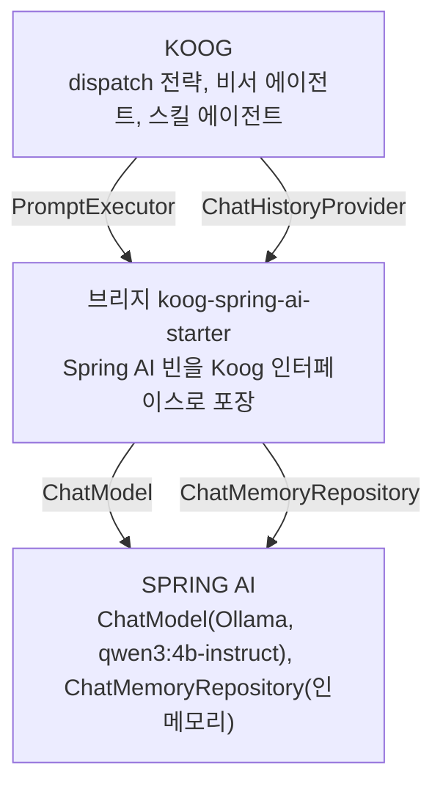
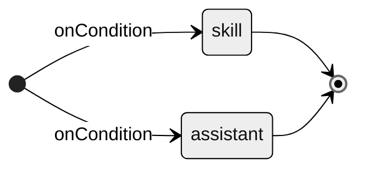

# Koog 세미나: Kotlin-native AI agents on the JVM

FDE팀 스터디 · 2026.10

## 2. 목차

| 구간 | 내용 | 장 | 시간 |
|---|---|---|---|
| 01 | Koog가 내세우는 것 | 3~5 | 2분 |
| 02 | Spring AI 스택에서 여섯 단계 | 6~13 | 7분 |
| 03 | Spring AI와 다른 점 | 14 | 1분 |
| 04 | Demo · 질의 | 15 | 3분 + 2분 |

## 3. Koog 소개

LLM 에이전트 프레임워크는 파이썬 생태계에서 먼저 나왔습니다. 2022년에 LangChain이 나왔고, 2023년에는 LangGraph와 CrewAI가 뒤따랐습니다. JVM 쪽은 2023년의 LangChain4j가 처음입니다. 저장소 소개문은 이 프로젝트를 "idiomatic Java"(Java다운 관용 스타일) 라이브러리라고 설명합니다. 2025년에는 JetBrains가 Kotlin 네이티브 프레임워크 Koog를 공개했습니다.

| 시기 | 연혁 |
|---|---|
| 2025.05 | 공개(Released) |
| 2026.03 | Java API |
| 2026.05 | 1.0. stable 모듈은 최소 1년 호환 보장 |
| 2026.09 | 1.3.0 |

출처: 연도는 GitHub 저장소 생성일 기준(langchain 2022-10, langchain4j 2023-06, langgraph 2023-08, crewAI 2023-10, koog 2025-05). "idiomatic Java"는 [langchain4j](https://github.com/langchain4j/langchain4j) 저장소 소개문. 공식 글 [Meet Koog](https://blog.jetbrains.com/ai/2025/05/meet-koog-empowering-kotlin-developers-to-build-ai-agents/) · [Koog 1.0](https://blog.jetbrains.com/ai/2026/05/koog-1-0-is-out-stable-core-better-interop-and-multiplatform-observability/) · [KotlinConf 2026](https://blog.jetbrains.com/kotlin/2026/05/kotlinconf26-keynote-highlights/) · [Koog Comes to Java](https://blog.jetbrains.com/ai/2026/03/koog-comes-to-java/) · [Releases](https://github.com/JetBrains/koog/releases)

## 4. Why Koog? 공식적으로 내세우는 것

> [!quote] "Koog is a JVM (Java and Kotlin) framework for building predictable, fault-tolerant and enterprise-ready AI agents …"
> 예측 가능하고, 장애를 견디고, 기업 환경에서 쓸 수 있는 에이전트. GitHub 저장소 소개문의 첫 문장입니다.

Why Koog 문서가 "기본 기능만 주는 프레임워크와 다른 점"으로 꼽는 것은 넷입니다.

- 그래프 워크플로: 에이전트의 동작을 프롬프트에 맡기지 않고 데이터 클래스와 그래프로 적어 통제
- 퍼시스턴스: 대화 메시지만이 아니라 실행 상태 전체를 체크포인트로 남김. 장애 복구와 되돌리기
- 긴 대화를 줄이는 히스토리 압축, 조건을 건 재시도, 이력까지 옮기는 LLM 전환
- 그래프, GOAP, LLM 플래너, 멀티 에이전트까지 한 프레임워크 안에서 조합

검증과 통합으로 내세우는 것은 다음과 같습니다.

- JetBrains 제품과 사내 에이전트에 쓰이며, ML 엔지니어가 다듬은 프롬프트와 전략이 들어 있다고 합니다. 어느 제품인지는 공식 자료가 밝히지 않습니다.
- Kotlin DSL과 Java API를 둘 다 제공합니다. 1.0부터 stable 모듈은 최소 1년간 깨지는 변경이 없습니다.
- Spring Boot, Spring AI, Ktor 연동. 멀티플랫폼과 OpenTelemetry 지원.

아래 여섯 단계는 이 중 그래프 워크플로, 퍼시스턴스, 관측 셋을 직접 돌려 봅니다. 나머지는 14장 표에 출처만 있습니다.

출처: [GitHub 저장소 소개(인용문)](https://github.com/JetBrains/koog) · [Why Koog](https://docs.koog.ai/why-koog/) · [KotlinConf 2026 키노트](https://blog.jetbrains.com/kotlin/2026/05/kotlinconf26-keynote-highlights/) · [Koog 1.0](https://blog.jetbrains.com/ai/2026/05/koog-1-0-is-out-stable-core-better-interop-and-multiplatform-observability/) · 예제 [Banking](https://docs.koog.ai/examples/Banking/) · [Chess](https://docs.koog.ai/examples/Chess/) · [MCP](https://docs.koog.ai/examples/GoogleMapsMcp/) · [Langfuse](https://docs.koog.ai/examples/Langfuse/)

## 5. 기능 범위

공식 문서 목차를 주제별로 다시 묶은 표입니다(문서는 버전 구분 없이 최신판, 현재 1.3.0). 굵은 여덟 개가 여섯 단계에서 직접 돌려 보는 기능입니다.

| 범주 | 기능 |
|---|---|
| 에이전트 | **기본형**, 그래프, 함수형, 플래너 β |
| 전략 | **커스텀 그래프**, 기본 제공 노드, 기본 제공 전략, 병렬 노드, 서브그래프, 노드 간 데이터 전달 |
| 도구 | **애노테이션**, 클래스 기반, 내장 도구, 커스텀 스키마 |
| 기능 | **챗 메모리**, **이벤트 핸들러**, 트레이싱, 장기 기억, **퍼시스턴스**, OpenTelemetry, 커스텀 기능 |
| 프롬프트 | 히스토리 압축, 멀티모달, 캐시 제어, 실패 처리, 응답 캐싱, 이력 직접 관리 |
| 프로토콜 | MCP, A2A, ACP, **Agent Skills** |
| 통합 | **Spring AI**, Spring Boot, Ktor, Bedrock AgentCore |
| 그 외 | 임베딩, RAG, 구조화 출력, 스트리밍, 커스텀 노드, 모더레이션, 직렬화, 테스트 |
| 플랫폼 | JVM, JS, WasmJS, Android, iOS |

직접 돌려 보는 여덟 기능의 한 줄 설명(문서 설명을 줄인 것):

- 기본형 에이전트: 전략을 직접 짜지 않고 run() 하나로 도는 에이전트
- 커스텀 그래프: 노드와 엣지 DSL로 실행 흐름을 직접 그림
- 애노테이션 도구: @Tool 붙인 함수가 곧 도구. 스키마는 자동 생성
- 챗 메모리: 대화 이력의 저장과 복원. Spring AI 저장소 어댑터 포함
- 이벤트 핸들러: 도구 호출 등 실행 이벤트에 거는 훅
- 퍼시스턴스: 실행 상태를 저장해 중단 지점부터 복원
- Agent Skills: SKILL.md 명세 지원. 폴더에서 찾고 카탈로그 프롬프트를 만듦
- Spring AI 통합: 기존 Spring AI 빈을 PromptExecutor로 잇는 브리지

출처: [docs.koog.ai](https://docs.koog.ai/) 목차 · [Spring AI integration](https://docs.koog.ai/spring-ai-integration/)

## 6. Spring AI 위에 Koog, 여섯 단계로

목적은 4장에서 Koog가 내세운 것 중 셋, 그래프 워크플로와 퍼시스턴스와 관측을 Spring AI 스택에서 확인하는 것입니다. 그 위에 만드는 것은 일정과 회사 말투를 아는 작은 비서입니다.

배치는 세 층입니다. 맨 아래가 이미 쓰는 Spring AI로, 모델(Ollama의 qwen3:4b-instruct)과 대화 저장소(인메모리)입니다. 가운데 브리지(koog-spring-ai-starter)가 그 빈들을 Koog 인터페이스로 포장합니다. 맨 위에서 Koog의 dispatch 전략 하나가 비서 에이전트와 스킬 에이전트를 지휘합니다. Spring AI를 재사용하는 것은 Koog의 전제가 아니라 이 구성의 선택입니다.



| 단계 | 주제 | 더하는 것 |
|---|---|---|
| 1단계 | 기본 에이전트 | AIAgent 하나와 입력 루프 |
| 2단계 | 도구 | @Tool 함수와 자동 생성 스키마 |
| 3단계 | 스킬 | 필요할 때 읽는 SKILL.md |
| 4단계 | 오케스트레이션 | 담당 에이전트 둘을 그래프로 |
| 5단계 | 챗 메모리 | 세션 ID로 이어지는 대화 |
| 6단계 | 퍼시스턴스 | 노드마다 체크포인트. 중단 뒤 이어서, 그리고 롤백 |
| 전 단계 | 관측 | 이벤트 핸들러가 찍는 터미널의 흐린 줄 |

출처: [Why Koog](https://docs.koog.ai/why-koog/)의 Spring AI 통합 항목 · [Spring AI integration](https://docs.koog.ai/spring-ai-integration/)

## 7. 1/6 기본 에이전트: AIAgent 하나로 시작

더하는 것은 AIAgent와 입력 루프입니다. 확인할 것은 REPL 응답 "5"입니다.

```kotlin
val agent = AIAgent(
    promptExecutor = promptExecutor,   // Spring AI 브리지가 만든 빈
    llmModel = KoogModels.QWEN3_4B_INSTRUCT,
    systemPrompt = "짧게 답한다.",
)
while (true) {
    print("❯ ")
    val line = readLine() ?: break
    println(agent.run(line))
}
```

```text
$ koog step1
❯ 2 더하기 3은?
5
```

- `AIAgent` 하나로 에이전트를 만듭니다. 전략을 안 적으면 기본 전략으로 동작합니다.
- 봐 둘 것은 `promptExecutor`입니다. 모델 호출을 맡는 Koog 인터페이스이고, Spring AI로 치면 ChatModel 자리입니다.
- 브리지는 Koog가 배포하는 Spring AI 연동 스타터(koog-spring-ai-starter-model-chat)입니다. ChatModel을 LLMClient로 감싼 PromptExecutor 빈을 등록합니다. Ollama 주소는 application.properties 그대로이고, 모델 이름은 코드의 LLModel이 매 호출 지정합니다.
- 여기까지는 단일 호출입니다. 입력과 답뿐이고, 다음 단계부터 도구, 스킬, 오케스트레이션, 메모리, 체크포인트를 차례로 더합니다.

코드는 Harness07.kt. REPL은 한 줄씩 읽어 실행하고 출력을 반복하는 대화형 루프(Read-Eval-Print Loop)입니다.

## 8. 2/6 도구: 시그니처가 곧 스키마

더하는 것은 @Tool 캘린더 함수입니다. 확인할 것은 도구 호출 왕복입니다.

```kotlin
class CalendarToolSet : ToolSet {
    private val entries = mutableMapOf("내일" to mutableListOf("10:00 팀 싱크", "14:00 디자인 리뷰"))
    @Tool
    @LLMDescription("날짜의 일정 목록을 돌려준다. 없으면 없음")
    fun schedules(@LLMDescription("날짜, 예: 내일") day: String): String {
        return entries[day]?.sorted()?.joinToString(", ") ?: "없음"
    }
    // add(day, time, title)는 같은 꼴. entries[day]에 넣는다
}
val calendar = CalendarToolSet()
toolRegistry = ToolRegistry { tools(calendar) }
```

평범한 Kotlin 함수입니다. 날짜를 받아 일정 문자열을 돌려줍니다. 한 일은 셋뿐입니다. 함수에 @Tool을 붙였고, 함수와 파라미터에 설명을 달았고, 이 함수를 ToolSet 클래스에 담아 레지스트리 한 줄로 넘겼습니다.

```text
❯ 내일 일정 알려줘
  dispatch    → assistant
  assistant   LLM #1 메시지 2개 → 도구 호출 schedules(day=내일)  1.0s
  assistant   schedules → 10:00 팀 싱크, 14:00 디자인 리뷰
  assistant   LLM #2 메시지 4개 → 답  1.1s
  assistant   완료 2.1s
내일은 10:00 팀 싱크, 14:00 디자인 리뷰가 있습니다.
```

- 도구는 원래 JSON 스키마로 모델에게 알려야 합니다. 여기서는 스키마를 한 줄도 쓰지 않았습니다. 함수 이름이 도구 이름이고, 파라미터가 스키마이고, 애노테이션이 설명입니다. Spring AI의 @Tool과 같은 방식입니다.
- 파라미터를 더하면 스키마도 따라 바뀝니다. 같은 꼴의 add(day, time, title)도 있습니다. 13장에서 씁니다.
- 도구를 고르고, 부르고, 결과로 답을 만드는 왕복은 기본 전략이 처리합니다.
- 캘린더는 메모리 안의 가짜입니다. 진짜 연동이면 return 안쪽만 바꾸면 됩니다.

> [!info] 터미널의 흐린 줄 읽는 법
> 답 위에 흐리게 찍히는 줄은 Koog 이벤트 핸들러로 남기는 실행 흐름입니다(Trace.kt).
>
> - `dispatch → …`: 라우터 전략이 들어간 노드. 판교 사투리는 skill, 나머지는 assistant(10장)
> - `LLM #n 메시지 N개 → 결정  시간`: 모델 호출 하나. 결정은 "도구 호출 이름(인자)" 아니면 "답". 도구 왕복이면 #1이 도구 호출, #2가 답. 첫 호출의 "(이력 M개)"는 챗 메모리가 실어 준 앞 대화 수(11장)
> - `도구이름 → 결과`: 도구가 돌려준 값. 파일은 글자 수
> - `완료 시간`: 담당 에이전트의 실행 전체
> - `persistence 중단된 실행 발견, … 다음부터 이어감`: 기동 때 완료 표시 없는 체크포인트를 찾았다는 뜻(12장)
> - `검증: …`, `롤백 뒤 …`: 비서 전략의 verify 노드와 reject 노드가 찍는 줄(13장)

출처: [Annotation-based tools](https://docs.koog.ai/tools/annotation-based-tools/)

## 9. 3/6 스킬: 필요할 때 읽는 SKILL.md

더하는 것은 SKILL.md와 파일 읽기 도구입니다. 확인할 것은 판교 사투리 변환입니다.

```markdown
---
name: pangyo-dialect
description: 평범한 한국어 문장을 판교 사투리(IT 회사 말투)로
  바꾼다. 강도 1부터 11까지. 사용자가 "판교 사투리"라고
  말하면 이 스킬을 쓴다.
---
## 강도
- 1~3: 부드러운 사내 메모 … 11: 기업 특이점
```

스킬은 frontmatter를 단 마크다운 파일 하나입니다. name과 description의 목록이 에이전트가 들고 있는 스킬 카탈로그가 됩니다. 본문에는 강도 1부터 11까지 지침이 있는데, 요청이 스킬에 해당할 때만 에이전트가 파일을 읽어 따릅니다. 프롬프트에 미리 싣지 않으니 토큰도 아낍니다.

```text
❯ 판교 사투리 3으로 바꿔 줘: 내일 회식 오세요
  dispatch    → skill
  skill       LLM #1 메시지 2개 → 도구 호출 __read_file__(path=…/pangyo-dialect/SKILL.md)  1.3s
  skill       __read_file__ → 2,047자
  skill       LLM #2 메시지 4개 → 답  4.9s
  skill       완료 6.2s
내일 회식 오세요 → 내일 회식 공유 드리고, 참석 여부는 편하게 싱크해 주세요.
```

- 스킬 에이전트가 파일 읽기 도구로 SKILL.md를 통째로 읽은 뒤 모델을 다시 불렀습니다. 결과는 강도 3, 부드러운 사내 메모입니다.
- Koog 몫은 둘입니다. 폴더에서 SKILL.md를 찾고, name과 description 목록을 프롬프트 문자열로 만들어 줍니다(1.3.0-beta). 나머지는 에이전트에 파일 읽기 도구를 쥐여 주는 것뿐입니다.
- Agent Skills는 Anthropic이 만들어 공개 표준으로 낸 형식입니다. Koog 밖에서도 통합니다.

출처: [Agent Skills](https://docs.koog.ai/skills/) (Koog) · 표준 명세 [agentskills.io](https://agentskills.io) (Anthropic)

## 10. 4/6 오케스트레이션: 담당 에이전트 둘을 그래프로

더하는 것은 조건 엣지 두 줄입니다. 확인할 것은 판교 사투리는 skill로, 나머지는 assistant로 가는 것입니다.

2단계의 캘린더 도구와 3단계의 스킬을 한 에이전트에 다 주면, 4B 로컬 모델은 프롬프트로 아무리 일러도 엉뚱한 도구를 짚습니다. 그래서 담당을 나눴습니다. 비서는 캘린더만, 스킬 에이전트는 스킬만 가집니다. 요청을 담당에게 보내는 길이 아래 전략입니다.

```kotlin
fun dispatchRouter(
    askSkill: suspend (String) -> String,
    askAssistant: suspend (String) -> String,
) = strategy<String, String>("dispatch") {
    val skill by node<String, String>("skill") { askSkill(it) }
    val assistant by node<String, String>("assistant") { askAssistant(it) }
    edge(nodeStart forwardTo skill onCondition { "판교사투리" in it.replace(" ", "") })
    edge(nodeStart forwardTo assistant onCondition { true })
    edge(skill forwardTo nodeFinish)
    edge(assistant forwardTo nodeFinish)
}
dispatchRouter(
    askSkill = { skillAgent().run(withLastAnswer(it)) },
    askAssistant = { assistantAgent().run(it, "demo") },
)
```

```text
❯ 판교 사투리 3으로 바꿔 줘: 내일 회식 오세요
  dispatch    → skill
❯ 내일 일정 알려줘
  dispatch    → assistant
```

노드 둘이 각각 담당 에이전트를 부르고, 분기는 if문이 아니라 엣지 선언입니다. 판교 사투리가 들어 있으면 skill로, 나머지는 assistant로 갑니다. 에이전트 둘을 그래프 하나가 지휘합니다. 4장에서 멀티 에이전트 오케스트레이션이라고 부른 것이 가장 작게는 이것입니다. 스킬 쪽에는 직전 비서 답변을 바꿀 원문으로 붙여 넘겨서, 방금 들은 일정을 그대로 판교 사투리로 만들 수 있습니다.

엣지 규칙:

- 엣지는 선언한 순서대로 검사됩니다.
- 넓은 조건(`onCondition { true }`)은 마지막에 둡니다. 앞에 오면 뒤 분기를 가립니다. 분기를 빠뜨려도 컴파일러는 모릅니다. when과 다른 점입니다.
- if문과 다른 점은 edge 줄이 실행문이 아니라 자료구조를 만든다는 것입니다. 그래서 `asMermaidDiagram()` 한 번에 아래 그림이 나오고, 노드 단위로 이벤트가 잡히고, 12장의 체크포인트가 노드 단위로 붙습니다.



`dispatchRouter().asMermaidDiagram()`의 출력입니다. 전략은 자료구조라서 실행 전에 그려집니다. 그리기 위해 방향과 테마 지시만 더했습니다.

출처: [Custom strategy graphs](https://docs.koog.ai/custom-strategy-graphs/)의 조건 분기(onCondition) 예제와 같은 꼴

## 11. 5/6 챗 메모리: 세션 ID로 이어지는 대화

더하는 것은 ChatMemory 기능과 세션 ID입니다. 확인할 것은 앞 일정을 도구 호출 없이 답하는 것입니다. 여기까지 비서는 요청마다 처음 보는 것처럼 답했습니다.

```kotlin
fun assistantAgent() = AIAgent(
    promptExecutor = promptExecutor,
    llmModel = KoogModels.QWEN3_4B_INSTRUCT,
    systemPrompt = "비서다. 짧게 답한다. " +
        "일정 질문에는 날짜마다 schedules 도구를 호출해야 한다. 예: '모레 일정은?' → schedules(day=모레). " +
        "도구 결과가 없음이면 없다고 답한다. 이력의 일정을 다른 날짜에 쓰지 않는다. 일정 추가에는 add 도구를 호출한다.",
    temperature = 0.0,
    toolRegistry = ToolRegistry { tools(calendar) },
) {
    install(ChatMemory) {
        chatHistoryProvider = historyProvider
    }
}
askAssistant = { assistantAgent().run(it, "demo") }
```

```text
❯ 아까 말한 첫 번째 일정이 뭐였지?
  dispatch    → assistant
  assistant   LLM #1 메시지 4개 (이력 2개) → 답  0.6s
  assistant   완료 0.6s
10:00 팀 싱크입니다.
```

- 비서 에이전트에 ChatMemory 기능을 install로 붙였습니다. 정할 것은 이력을 어디에 둘지, chatHistoryProvider 하나입니다. 여기서는 브리지의 챗 메모리 스타터가 Spring AI의 ChatMemoryRepository를 감싼 빈을 등록합니다. 저장소는 Spring AI 것 그대로입니다.
- run의 둘째 인자가 세션 ID입니다. 실행 시작 때 이 세션의 이력을 읽고, 끝나면 이번 대화를 저장합니다. 세션 ID가 다르면 이력도 분리됩니다.
- 이 에이전트는 요청마다 새로 만드는데도 대화가 이어집니다. 이력을 쥔 것은 에이전트가 아니라 ChatHistoryProvider입니다.
- 출력을 보면 모델 호출 한 번에 메시지 4개, 그중 이력이 2개입니다. 2단계의 질문과 답입니다. 도구 호출 없이 답으로 끝났습니다.

출처: [Chat memory](https://docs.koog.ai/features/chat-memory/) · [Spring AI integration](https://docs.koog.ai/spring-ai-integration/)의 Chat Memory Starter

## 12. 6/6 퍼시스턴스: 중단 뒤 이어서

더하는 것은 Persistence 기능입니다. 확인할 것은 강제 종료 뒤 재시작하면 중단 지점부터 완료하는 것입니다. 4장에서 공식이 가장 세게 내세우는 것입니다.

```kotlin
val checkpoints = JVMFilePersistenceStorageProvider(Path.of("/tmp/koog-checkpoints"))
install(Persistence) {
    storage = checkpoints
    enableAutomaticPersistence = true
}
checkpoints.getLatestCheckpoint("demo")?.takeUnless { it.isTombstone() }?.let {
    traceLine("persistence", "중단된 실행 발견, $node 다음부터 이어감")
    println(assistantAgent().run("", "demo"))
}
```

Persistence 기능을 붙이고 파일 저장소를 줬습니다. 이러면 노드가 끝날 때마다 체크포인트가 파일로 남습니다. 메시지 이력, 마지막 노드와 출력, 모델, 도구 목록입니다. 정상 완료되면 완료 표시가 남습니다. 프로그램은 뜰 때 완료 표시 없는 체크포인트가 있으면 그 노드 다음부터 마저 돌립니다.

```text
❯ 내일 일정 알려 주고, 일정마다 준비할 것을 다섯 가지씩 이유와 함께 제안해 줘
  dispatch    → assistant
  assistant   LLM #1 메시지 6개 (이력 4개) → 도구 호출 schedules(day=내일)  0.8s
  assistant   schedules → 10:00 팀 싱크, 14:00 디자인 리뷰
[1]    11388 killed     java -jar …          ← 터미널 1에서 pkill -9
$ koog
  persistence 중단된 실행 발견, verify 다음부터 이어감
  assistant   LLM #1 메시지 8개 → 답  11.6s
  assistant   완료 11.7s
내일의 일정은 다음과 같습니다:
1. **10:00 팀 싱크** …
```

모델이 답을 만드는 도중에 프로세스를 죽였습니다. 죽인 시점의 화면에 `LLM #2` 줄이 없습니다. 다시 뜨자마자 "중단된 실행 발견, verify 다음부터"가 찍히고, 모델을 다시 부르지도 도구를 다시 부르지도 않고 마지막 호출 하나로 답을 끝냈습니다.

- 저장 키는 run의 둘째 인자(runId)입니다. 문서는 에이전트에 묶인다고 쓰지만 1.3.0 코드는 이 값으로 저장하고 찾습니다. 챗 메모리의 세션 ID와 같은 값이라, 세션 하나가 대화 이력과 실행 상태를 함께 가집니다.
- 저장소는 인터페이스 하나입니다. 인메모리, 파일(이 구성), JDBC(Postgres · MySQL · H2) 구현체가 있고 JDBC는 DataSource를 받습니다.
- 되돌리기는 다음 장입니다.

출처: [Agent persistence](https://docs.koog.ai/features/agent-persistence/) · 완료 표시와 파일 저장소는 문서에 없고 [1.3.0 소스](https://github.com/JetBrains/koog/tree/1.3.0)에 있음 · JDBC 구현체는 [agents-features-persistence-jdbc 1.3.0](https://repo1.maven.org/maven2/ai/koog/agents-features-persistence-jdbc/1.3.0/), 문서에는 아직 없음

## 13. 6/6 퍼시스턴스: 롤백과 반대 도구

더하는 것은 검증 노드와 반대 도구 등록입니다. 확인할 것은 겹치는 일정을 도구 실행 전으로 되돌리는 것입니다.

같은 체크포인트로 되돌리기도 합니다. 비서에 전략을 하나 줬습니다. 평소 경로는 receive, request, execute, verify, report 순서이고, 도구를 실행한 뒤 검증 노드 verify가 하나 더 있습니다.

```kotlin
val verify by node<ReceivedToolResults, ReceivedToolResults>("verify") { results ->
    if (results.toolResults.any { it.tool == "add" }) conflict = calendar.conflictOfLastAdded()
    if (conflict != null) {
        val before = checkpoints.getCheckpoints(runId)
            .filter { it.graphProperties?.nodePath?.endsWith("/receive") == true }
            .maxBy { it.createdAt }
        persistence().rollbackToCheckpoint(before.checkpointId, this)
    }
    results
}
edge(receive forwardTo reject onCondition { conflict != null })
rollbackToolRegistry = RollbackToolRegistry.builder()
    .registerRollback(calendar::add, calendar::remove).build()
```

- verify: 추가한 일정이 같은 시각의 다른 일정과 겹치면, 도구 실행 전 체크포인트를 골라 `rollbackToCheckpoint` 한 줄입니다. 체크포인트는 노드 뒤마다 남으니 "도구 실행 전"은 요청을 받는 receive 노드 뒤의 것입니다. 시작 노드에는 안 남아서 받는 노드를 뒀습니다.
- 엣지 한 줄: 롤백 뒤 실행이 receive 다음부터 다시 흐르므로, receive의 첫 엣지가 겹침이면 reject로 보냅니다. reject는 모델을 부르지 않고 겹쳐서 추가하지 않았다는 문장을 만듭니다.
- 반대 도구 등록: add의 반대가 remove라고 등록합니다(install(Persistence) 안). 되돌릴 때 체크포인트 뒤의 도구 호출마다 반대 도구를 같은 인자로 역순 호출합니다. 문서에 있는 규칙입니다.

```text
❯ 내일 14시에 치과 추가해 줘
  dispatch    → assistant
  assistant   LLM #1 메시지 8개 (이력 6개) → 도구 호출 add(day=내일, time=14:00, title=치과)  2.4s
  assistant   add → 추가됨: 내일 14:00 치과
  assistant   검증: 14:00 치과 겹침 (14:00 디자인 리뷰) → 도구 실행 전 체크포인트로 롤백
  assistant   롤백 뒤 내일 일정: 10:00 팀 싱크, 14:00 디자인 리뷰
내일 14:00은 이미 디자인 리뷰 시간이라 치과 일정을 추가하지 않았습니다.
```

- add가 돌아서 추가됐고, 검증이 디자인 리뷰와 겹친다고 롤백했습니다. 롤백 뒤 목록에서 치과가 빠졌습니다. 코드 어디에도 remove를 부르는 줄이 없습니다. Persistence가 불렀습니다.
- 프롬프트와 실행 지점도 receive 다음으로 돌아가서, receive의 첫 엣지가 reject로 보내고 모델 호출 없이 답했습니다. 이 턴은 이력에 남지 않습니다.
- 되돌리기는 노드가 끝난 뒤 적용됩니다. verify 안에서 목록을 찍으면 아직 그대로입니다. 반대 도구는 이벤트에 안 잡혀 트레이스에 remove 줄이 없습니다.

출처: [Agent persistence](https://docs.koog.ai/features/agent-persistence/)의 Rolling back all side-effects produced by tools · 롤백 뒤 실행 위치와 시작 노드 제외는 문서에 없고 [1.3.0 소스](https://github.com/JetBrains/koog/tree/1.3.0)에서 확인

## 14. Spring AI와 다른 점

모델 호출, 도구, 챗 메모리, 관측은 Spring AI에도 같은 역할로 있습니다. 여섯 단계에서 쓴 것 중 Spring AI 코어에 없는 것은 셋입니다. 스킬 카탈로그(커뮤니티 spring-ai-agent-utils에는 있음), 노드와 엣지가 자료구조인 전략 그래프, 노드 단위 체크포인트로 복구하고 되돌리는 퍼시스턴스입니다.

| 기능 | Spring AI | Koog | 본 곳 |
|---|---|---|---|
| 모델 호출 | ChatClient | AIAgent. PromptExecutor는 브리지가 ChatModel을 감쌈 | 1단계 |
| 도구 | @Tool | @Tool. 같은 방식 | 2단계 |
| 스킬 | **코어에 없음**. 커뮤니티 spring-ai-agent-utils의 SkillsTool | discoverSkills, 카탈로그 프롬프트(1.3.0-beta) | 3단계 |
| 오케스트레이션 | **코드로 호출 순서를 씀** | 전략 그래프. 노드와 엣지가 자료구조 | 4단계 |
| 챗 메모리 | ChatMemory + MessageChatMemoryAdvisor | ChatMemory 기능. 저장소는 Spring AI 것 재사용 | 5단계 |
| 퍼시스턴스 | **실행 상태 체크포인트 없음**. 메시지 저장은 ChatMemory 저장소 | Persistence. 노드마다 체크포인트, 세션 단위 복구와 롤백 | 6단계 |
| 관측 | Micrometer 관측 | EventHandler. Tracing과 OpenTelemetry는 출처만 | 전 단계 |
| 그 밖 | 모델 호출 재시도 | 히스토리 압축 전략, 재시도 기능, LLM 전환(이력 재작성), GOAP·LLM 플래너 | 출처만 |

압축 전략, 재시도 기능, 이력까지 옮기는 LLM 전환, 플래너는 돌려 보지 않았습니다. 출처만 있습니다.

Koog를 꺼내는 지점은 모델 호출이 아니라 그 바깥입니다. 실행 논리를 그래프로 두고 그 상태를 남겨야 할 때입니다. 이것이 공식 주장이고, 여섯 단계에서 그 셋을 확인했습니다.

출처: [Why Koog](https://docs.koog.ai/why-koog/) · Spring AI 열은 1.1.6 코어 모듈 기준 · 스킬의 커뮤니티 구현은 [spring-ai-agent-utils](https://github.com/spring-ai-community/spring-ai-agent-utils)의 SkillsTool

## 15. Demo

완성한 비서에 넣는 입력입니다.

> [!info] 입력 규칙
> - "판교 사투리"가 들어간 문장은 스킬 에이전트로 갑니다. 스킬 에이전트는 대화 이력이 없고, 대신 직전 비서 답변이 "바꿀 원문"으로 붙어 넘어갑니다. 콜론이 있으면 콜론 뒤 문장을 바꾸고, 없으면 직전 답변을 바꿉니다. 강도는 꼭 적고, 공지는 7을 권합니다. 11은 SKILL.md의 예시 문구가 섞일 때가 있습니다.
> - 나머지 문장은 비서로 가고 기억이 있으며, 일정 질문이면 캘린더 도구를 부릅니다.
> - 캘린더는 메모리 안의 가짜입니다. 기본 일정은 "내일"에만 두 건 있고 다른 날짜는 "없음"입니다. add로 추가한 일정은 그 날짜 문자열에 붙고 프로세스 메모리에만 있습니다. 같은 시각에 다른 일정이 있으면 13장처럼 롤백됩니다.
> - 4B 모델이라 긴 문장, 영어 섞인 문장, 여러 요청을 한 줄에 넣은 문장은 흔들립니다. 한 줄에 한 가지만 받습니다.

돌려 본 입력:

| 입력 | 보여주는 것 |
|---|---|
| `두 번째 일정은 몇 시였지?` | 이력에서 답함 |
| `내 이름은 준이야` 뒤에 `내 이름이 뭐지?` | 도구 없이 기억만으로 답함 |
| `내일 16시에 치과 추가해 줘` 뒤에 `내일 일정 알려줘` | 부작용 있는 도구. 겹치지 않아 롤백 없음 |
| `내일 10시에 운동 추가해 줘` | 팀 싱크와 겹쳐 13장과 같은 롤백 |
| `판교 사투리 7로 바꿔 줘: 점심 같이 먹어요` | 스킬 강도 중간 |
| `모레 일정은?` | 없는 날은 없다고 답함 |
| `내일 일정 알려줘` 뒤에 `판교 사투리 7로 일정 공지 만들어 줘` | 비서 답변을 스킬이 이어받음 |
| `오늘 점심 뭐 먹을까?` | 일정 아닌 질문은 도구 없이 비서가 답함 |
| `판교사투리란?` | 스킬 요청은 띄어쓰기와 무관하게 스킬 에이전트로. 질문도 파일을 읽고 답함 |

## 질문과 답

- **진짜 캘린더면?** @Tool 자리를 MCP 도구 레지스트리로 바꾸면 됩니다. Koog가 MCP 서버의 도구를 같은 ToolRegistry로 가져옵니다(5장의 MCP).
- **LangChain4j와 차이는?** 그래프를 1급 자료구조로 두느냐가 갈림길입니다. 10장과 12장이 그 자리입니다.
- **모델을 바꾸면?** 접속은 application.properties, 모델 이름은 코드의 LLModel입니다. 브리지가 에이전트의 LLModel id를 매 호출 ChatOptions로 넘겨 프로퍼티의 모델 이름을 덮습니다. 그래서 둘 다 바꿔야 합니다.
- **분기 누락은 어떻게 막나?** true 받침 엣지를 관례로 두는 수밖에 없습니다. when 같은 전수 검사는 없습니다.
- **체크포인트 키가 왜 세션인가?** Persistence는 runId로 저장하고 찾는데, run의 둘째 인자가 그 runId입니다. 공식 문서는 "에이전트에 묶인다"고 쓰는데, 코드로는 run 단위입니다. 에이전트 id만 주고 둘째 인자를 비우면 실행마다 새 키라 복구가 안 됩니다.
- **체크포인트를 실무에선 어디에 저장하나?** 저장소는 인터페이스 하나이고 구현체를 갈아 끼웁니다. 인메모리는 테스트용, 파일은 인스턴스 하나일 때, 실무는 JDBC 모듈입니다. Postgres, MySQL, H2 구현체가 DataSource를 받고 보관 기한도 있습니다. 1.3.0으로 Maven Central에 있는데 공식 문서에는 아직 안 적혀 있습니다. 벡터 DB는 체크포인트 용도가 아닙니다. runId로 마지막 것을 찾는 키-값 데이터라서요.
- **롤백하면 그 턴의 대화는?** 이력에 안 남습니다. receive 뒤 체크포인트에는 이 턴의 질문이 아직 없고(질문은 모델 호출 노드가 프롬프트에 붙임), 롤백이 프롬프트를 그 상태로 돌려놓은 채 모델 호출 없이 끝나서요.
- **remove가 트레이스에 안 보이는데?** 반대 도구는 Persistence가 도구 객체를 직접 실행해서 EventHandler의 도구 이벤트에 안 잡힙니다. 롤백 뒤 목록으로 확인하고, 테스트는 도구 안의 호출 기록으로 단정합니다.
- **되돌리기가 바로 안 되던데?** rollbackToCheckpoint는 복원 데이터를 컨텍스트에 넣어 두고, 노드가 끝난 뒤 전략 실행기가 적용합니다. 반대 도구, 실행 지점, 프롬프트 순입니다. 노드 안에서 목록을 찍으면 아직 그대로입니다.
- **재시작 뒤 챗 메모리는?** 저장소가 인메모리라 재시작하면 비는데, 12장처럼 재개되면 체크포인트의 프롬프트에 앞 대화가 들어 있어 그대로 다시 저장됩니다. 재개할 게 없으면 빕니다. JDBC 저장소로 바꾸면 둘 다 남습니다.
- **비서한테 "뭐 할 수 있어?"라고 물으면?** 비서는 스킬 목록을 모릅니다. 담당을 나눈 대가입니다. 카탈로그를 비서 프롬프트에 넣어 봤는데 4B의 말투가 실행마다 흔들려서 뺐습니다. 스킬 이름을 대면 스킬 에이전트가 파일을 읽고 설명합니다. "판교사투리란?"처럼요.
- **흐린 줄은 뭔가?** Koog의 EventHandler 기능입니다. 노드 진입, 모델 호출 완료(도구 호출인지 답인지, 걸린 시간), 도구 결과, 에이전트 완료 이벤트에 콜백을 걸어 한 줄씩 찍습니다. 에이전트마다 install 한 줄, 출력 형식은 Trace.kt 한 파일입니다.
- **전략 그림은 어디까지 나오나?** asMermaidDiagram()이 Mermaid 텍스트를 돌려줍니다. 노드와 엣지는 나오지만 조건식 내용은 안 나오고 onCondition이라고만 적힙니다.
- **tool과 tools 차이는?** tools는 @Tool 함수를 품은 클래스를 통째로 스캔하고, tool은 완성된 Tool 객체 하나를 넣습니다.
