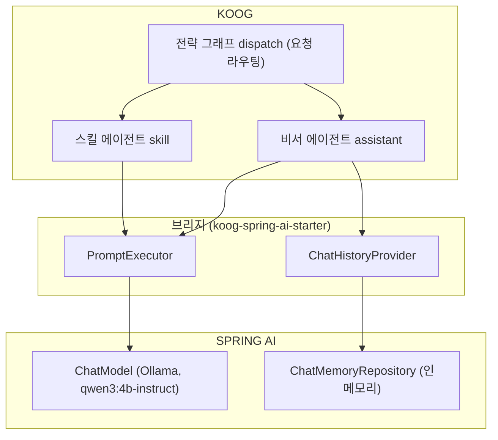
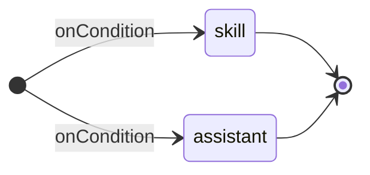

# Koog : Kotlin-native AI agents on the JVM

FDE팀 스터디 · 2026.10

## Koog 소개

LLM 에이전트 프레임워크는 파이썬 생태계에서 먼저 나왔습니다. 2022년에 LangChain이 나왔고 2023년에는 LangGraph와 CrewAI가 뒤따랐습니다. JVM 쪽은 2023년의 LangChain4j가 처음입니다. 저장소 소개문은 이 프로젝트를 "idiomatic Java"(Java다운 관용 스타일) 라이브러리라고 설명합니다. 2025년에는 JetBrains가 Kotlin 네이티브 프레임워크 Koog를 공개했습니다.

| 시기      | 연혁                          |
| ------- | --------------------------- |
| 2025.05 | 공개(Released)                |
| 2026.03 | Java API                    |
| 2026.05 | 1.0. stable 모듈은 최소 1년 호환 보장 |
| 2026.09 | 1.3.0                       |

출처: 연도는 GitHub 저장소 생성일 기준(langchain 2022-10, langchain4j 2023-06, langgraph 2023-08, crewAI 2023-10, koog 2025-05). "idiomatic Java"는 [langchain4j](https://github.com/langchain4j/langchain4j) 저장소 소개문. 공식 글 [Meet Koog](https://blog.jetbrains.com/ai/2025/05/meet-koog-empowering-kotlin-developers-to-build-ai-agents/) · [Koog 1.0](https://blog.jetbrains.com/ai/2026/05/koog-1-0-is-out-stable-core-better-interop-and-multiplatform-observability/) · [KotlinConf 2026](https://blog.jetbrains.com/kotlin/2026/05/kotlinconf26-keynote-highlights/) · [Koog Comes to Java](https://blog.jetbrains.com/ai/2026/03/koog-comes-to-java/) · [Releases](https://github.com/JetBrains/koog/releases)

## Why Koog? 공식적으로 내세우는 것

> [!quote] "Koog is a JVM (Java and Kotlin) framework for building predictable, fault-tolerant and enterprise-ready AI agents …"
>
> 예측 가능하고, 장애를 견디고, 엔터프라이즈 환경에서 쓸 수 있는 에이전트. GitHub 저장소 소개문의 첫 문장입니다.

Why Koog 문서는 "기본 기능만 주는 프레임워크와 다른 점"으로 네 가지를 꼽습니다.

- 그래프 워크플로: 에이전트의 동작을 프롬프트에 맡기지 않고 데이터 클래스와 그래프로 적어 통제
- 퍼시스턴스: 대화 메시지만이 아니라 실행 상태 전체를 체크포인트로 남김. 장애 복구와 되돌리기
- 긴 대화를 줄이는 히스토리 압축, 조건을 건 재시도, 이력까지 옮기는 LLM 전환
- 그래프, GOAP, LLM 플래너, 멀티 에이전트까지 한 프레임워크 안에서 조합

검증과 통합 면에서는 이런 점을 내세웁니다.

- JetBrains 제품과 사내 에이전트에 쓰이고, ML 엔지니어가 다듬은 프롬프트와 전략이 들어 있다고 합니다.
- Kotlin DSL과 Java API를 둘 다 제공합니다. 1.0부터 stable 모듈은 최소 1년간 깨지는 변경이 없습니다.
- Spring Boot, Spring AI, Ktor 연동. 멀티플랫폼과 OpenTelemetry 지원.


출처: [GitHub 저장소 소개(인용문)](https://github.com/JetBrains/koog) · [Why Koog](https://docs.koog.ai/why-koog/) · [KotlinConf 2026 키노트](https://blog.jetbrains.com/kotlin/2026/05/kotlinconf26-keynote-highlights/) · [Koog 1.0](https://blog.jetbrains.com/ai/2026/05/koog-1-0-is-out-stable-core-better-interop-and-multiplatform-observability/) · 예제 [Banking](https://docs.koog.ai/examples/Banking/) · [Chess](https://docs.koog.ai/examples/Chess/) · [MCP](https://docs.koog.ai/examples/GoogleMapsMcp/) · [Langfuse](https://docs.koog.ai/examples/Langfuse/)

## 기능 범위

공식 문서 목차를 주제별로 다시 묶은 표이고, 굵은 여덟 기능은 여섯 단계에서 직접 돌려 봅니다.

| 범주   | 기능                                                                    |
| ---- | --------------------------------------------------------------------- |
| 에이전트 | **기본형**, 그래프, 함수형, 플래너 β                                              |
| 전략   | **커스텀 그래프**, 기본 제공 노드, 기본 제공 전략, 병렬 노드, 서브그래프, 노드 간 데이터 전달            |
| 도구   | **애노테이션**, 클래스 기반, 내장 도구, 커스텀 스키마                                     |
| 기능   | **챗 메모리**, **이벤트 핸들러**, 트레이싱, 장기 기억, **퍼시스턴스**, OpenTelemetry, 커스텀 기능 |
| 프롬프트 | 히스토리 압축, 멀티모달, 캐시 제어, 실패 처리, 응답 캐싱, 이력 직접 관리                          |
| 프로토콜 | MCP, A2A, ACP, **Agent Skills**                                       |
| 통합   | **Spring AI**, Spring Boot, Ktor, Bedrock AgentCore                   |
| 그 외  | 임베딩, RAG, 구조화 출력, 스트리밍, 커스텀 노드, 모더레이션, 직렬화, 테스트                       |
| 플랫폼  | JVM, JS, WasmJS, Android, iOS                                         |

직접 돌려 보는 여덟 기능의 한 줄 설명(문서 설명을 줄인 것):

- 기본형 에이전트: 전략을 직접 짜지 않고 run() 하나로 도는 에이전트
- 커스텀 그래프: 노드와 엣지 DSL로 실행 흐름을 직접 그림
- 애노테이션 도구: @Tool 붙인 함수가 곧 도구. 스키마는 자동 생성
- 챗 메모리: 대화 이력의 저장과 복원. Spring AI 저장소 어댑터 포함
- 이벤트 핸들러: 도구 호출 등 실행 이벤트에 거는 훅
- 퍼시스턴스: 실행 상태를 저장해 중단 지점부터 복원
- Agent Skills: SKILL.md 명세 지원. 폴더에서 찾고 카탈로그 프롬프트를 만듦
- Spring AI 통합: 기존 Spring AI 빈을 PromptExecutor로 잇는 브리지

출처: [docs.koog.ai](https://docs.koog.ai/) 목차(버전 구분 없는 최신판, 현재 1.3.0) · [Spring AI integration](https://docs.koog.ai/spring-ai-integration/)

## Spring AI 위에 Koog, 여섯 단계로

Why Koog가 내세운 것 가운데 그래프 워크플로, 퍼시스턴스, 관측 셋을 Spring AI 스택에서 확인합니다. 그 위에 일정과 회사 말투를 아는 작은 비서를 만듭니다.

구성은 세 층입니다. 맨 아래는 이미 쓰고 있는 Spring AI로, 모델(Ollama의 qwen3:4b-instruct)과 대화 저장소(인메모리)가 여기 있습니다. 가운데 브리지(koog-spring-ai-starter)가 이 빈들을 Koog 인터페이스로 감쌉니다. 맨 위에서는 Koog의 전략 그래프 하나(dispatch)가 요청을 비서 에이전트(assistant)와 스킬 에이전트(skill)에 나눠 보냅니다. 괄호 안은 실행 기록에 찍히는 이름입니다. 이 그래프는 오케스트레이션 단계에서 만듭니다. Spring AI 재사용은 이 구성의 선택입니다. Koog의 전제는 아닙니다.



| 단계 | 주제 | 더하는 것 |
|---|---|---|
| 1단계 | 기본 에이전트 | AIAgent 하나와 입력 루프 |
| 2단계 | 도구 | @Tool 함수와 자동 생성 스키마 |
| 3단계 | 스킬 | 필요할 때 읽는 SKILL.md |
| 4단계 | 오케스트레이션 | 담당 에이전트 둘을 그래프로 |
| 5단계 | 챗 메모리 | 세션 ID로 이어지는 대화 |
| 6단계 | 퍼시스턴스 | 노드마다 체크포인트. 중단 뒤 이어서, 그리고 롤백 |
| 전 단계 | 관측 | 이벤트 핸들러가 남기는 실행 기록. 각 단계 출력에서 답 위에 들여쓴 줄 |

출처: [Why Koog](https://docs.koog.ai/why-koog/)의 Spring AI 통합 항목 · [Spring AI integration](https://docs.koog.ai/spring-ai-integration/)

## 1/6 기본 에이전트: AIAgent 하나로 시작

AIAgent 하나와 입력 루프로 시작합니다. REPL이 "5"라고 답하면 됩니다.

```kotlin
val agent = AIAgent(
    promptExecutor = promptExecutor,   // Spring AI 브리지가 만든 빈
    llmModel = KoogModels.QWEN3_4B_INSTRUCT,
    systemPrompt = "짧게 답한다.",
)
while (true) {
    print("❯ ")
    val line = readLine() ?: break
    println(agent.run(line))
}
```

```text
$ koog step1
❯ 2 더하기 3은?
5
```

- `AIAgent` 하나로 에이전트를 만듭니다. 전략을 안 적으면 기본 전략으로 동작합니다.
- `promptExecutor`가 눈여겨볼 자리입니다. 모델 호출을 맡는 Koog 인터페이스로, Spring AI의 ChatModel에 해당합니다.
- 브리지는 Koog가 배포하는 Spring AI 연동 스타터(koog-spring-ai-starter-model-chat)로, ChatModel을 LLMClient로 감싼 PromptExecutor 빈을 등록합니다. Ollama 주소는 application.properties의 값을 그대로 쓰고, 모델 이름은 코드의 LLModel이 호출마다 지정합니다.
- 여기까지는 입력과 답뿐인 단일 호출입니다. 다음 단계부터 도구, 스킬, 오케스트레이션, 메모리, 체크포인트를 차례로 더합니다.

REPL(Read-Eval-Print Loop)은 한 줄씩 읽어 실행하고 결과를 찍는 일을 반복하는 대화형 루프입니다.

## 2/6 도구: 시그니처가 곧 스키마

@Tool 캘린더 함수를 더하고 도구 호출 왕복을 확인합니다.

```kotlin
@LLMDescription("캘린더")
class CalendarToolSet(private val store: Path) : ToolSet {
    private val entries = load()   // 텍스트 파일 하나. 없으면 내일 두 건으로 시작

    @Tool
    @LLMDescription("날짜의 일정 목록을 돌려준다. 없으면 없음")
    fun schedules(@LLMDescription("날짜, 예: 내일") day: String): String {
        return entries[day]?.sorted()?.joinToString(", ") ?: "없음"
    }
    // add(day, time, title)는 같은 꼴. entries[day]에 넣고 파일에 저장
}
val calendar = CalendarToolSet(Path.of("data/koog-calendar.txt"))
toolRegistry = ToolRegistry { tools(calendar) }
```

날짜를 받아 일정 문자열을 돌려주는 평범한 Kotlin 함수입니다. 한 일은 셋뿐입니다. 함수에 @Tool을 붙이고 함수와 파라미터에 설명을 달았습니다. 이 함수를 담은 ToolSet 클래스를 레지스트리 한 줄로 넘겼습니다.

```text
❯ 내일 일정 알려줘
  dispatch    → assistant
  assistant   LLM #1 메시지 2개 → 도구 호출 schedules(day=내일)  1.0s
  assistant   schedules → 10:00 팀 싱크, 14:00 디자인 리뷰
  assistant   LLM #2 메시지 4개 → 답  1.1s
  assistant   완료 2.1s
내일은 10:00 팀 싱크, 14:00 디자인 리뷰가 있습니다.
```

- 도구는 원래 JSON 스키마로 모델에게 알려야 합니다. 여기서는 스키마를 한 줄도 쓰지 않았습니다. 함수 이름이 도구 이름, 파라미터가 스키마, 애노테이션이 설명이 됩니다. Spring AI의 @Tool도 같은 방식입니다.
- 파라미터를 더하면 스키마도 따라 바뀝니다. 같은 꼴로 만든 add(day, time, title)는 롤백 절에서 씁니다.
- 도구를 고르고, 부르고, 결과로 답을 만드는 왕복은 기본 전략이 맡습니다.
- 캘린더는 텍스트 파일 하나에 저장하는 가짜입니다. 추가한 일정은 재시작 뒤에도 남습니다. 실제 캘린더에 연동하려면 return 안쪽만 바꾸면 됩니다.

> [!info] 실행 기록 줄 읽는 법
> 출력에서 답 위에 들여쓴 줄은 Koog 이벤트 핸들러로 남긴 실행 기록입니다.
>
> - `dispatch → assistant`: 요청이 비서 에이전트(assistant)로 갔다는 기록. 보내는 쪽 dispatch는 오케스트레이션 절에서
> - `LLM #n 메시지 N개 → 결정  시간`: 모델 호출 하나. N은 보낸 메시지 수로, #1은 시스템 메시지와 질문 둘, #2는 도구 호출과 결과가 붙어 넷. 결정은 "도구 호출 이름(인자)" 아니면 "답"
> - `schedules → …`: 도구가 돌려준 값
> - `완료 시간`: 에이전트 실행 전체

출처: [Annotation-based tools](https://docs.koog.ai/tools/annotation-based-tools/)

## 3/6 스킬: 필요할 때 읽는 SKILL.md

더하는 것은 SKILL.md와 파일 읽기 도구입니다. 확인할 것은 판교 사투리 변환입니다.

```markdown
---
name: pangyo-dialect
description: 평범한 한국어 문장을 판교 사투리(IT 회사 말투)로 바꾼다. 강도 1부터 11까지. 사용자가 "판교 사투리"라고 말하면 이 스킬을 쓴다.
---

# 판교 사투리 변환

입력 문장을 지정된 강도의 판교 사투리로 바꾼다. 의미와 사실은 유지한다.
...

## 강도
- 1~3: 부드러운 사내 메모. 존댓말, 짧게. 판교 어휘는 한두 개만(공유, 이슈, 싱크).
- 4~6: 공지 문체. "안내드립니다", "협조 부탁드립니다". 슬랙·지라 같은 도구 이름이 등장.
...
- 11: 기업 특이점. 모든 명사는 이니셔티브, 모든 모임은 싱크, 모든 실수는 레슨런이 된다. 당연한 일일수록 거창하게 포장하고, 사소한 부탁도 전사 프로젝트처럼 말한다. 과장을 최대로.
```

스킬은 frontmatter가 달린 마크다운 파일 하나입니다. name과 description 목록이 에이전트가 들고 있는 스킬 카탈로그가 됩니다. 본문에는 강도 1부터 11까지의 지침이 있는데, 에이전트는 요청이 스킬에 해당할 때만 파일을 읽어 따릅니다. 프롬프트에 미리 싣지 않으니 토큰도 아낍니다.

```text
❯ 판교 사투리 3으로 바꿔 줘: 내일 회식 오세요
  dispatch    → skill
  skill       LLM #1 메시지 2개 → 도구 호출 __read_file__(path=…/pangyo-dialect/SKILL.md)  1.3s
  skill       __read_file__ → 2,047자
  skill       LLM #2 메시지 4개 → 답  4.9s
  skill       완료 6.2s
내일 회식 오세요 → 내일 회식 공유 드리고, 참석 여부는 편하게 싱크해 주세요.
```

- 스킬 에이전트가 파일 읽기 도구로 SKILL.md를 통째로 읽은 뒤 모델을 다시 불렀습니다. 결과는 강도 3, 부드러운 사내 메모입니다.
- Koog는 폴더에서 SKILL.md를 찾고 name과 description 목록을 프롬프트 문자열로 만들어 주는 데까지 합니다(1.3.0-beta). 나머지는 에이전트에 파일 읽기 도구를 쥐여 주는 것뿐입니다.
- Agent Skills는 Anthropic이 만들어 공개 표준으로 낸 형식입니다. Koog 밖에서도 통합니다.

출처: [Agent Skills](https://docs.koog.ai/skills/) (Koog) · 표준 명세 [agentskills.io](https://agentskills.io) (Anthropic)

## 4/6 오케스트레이션: 담당 에이전트 둘을 그래프로

조건 엣지 두 줄을 더합니다. 판교 사투리는 skill로, 나머지는 assistant로 가는지 확인합니다.

2단계의 캘린더 도구와 3단계의 스킬을 한 에이전트에 다 주면, 4B 로컬 모델은 프롬프트로 아무리 일러도 엉뚱한 도구를 짚습니다. 그래서 담당을 나눴습니다. 비서는 캘린더만, 스킬 에이전트는 스킬만 가집니다. 요청을 담당에게 보내는 길이 아래 전략입니다.

```kotlin
fun dispatchRouter(
    askSkill: suspend (String) -> String,
    askAssistant: suspend (String) -> String,
) = strategy<String, String>("dispatch") {
    val skill by node<String, String>("skill") { askSkill(it) }
    val assistant by node<String, String>("assistant") { askAssistant(it) }
    
    edge(nodeStart forwardTo skill onCondition { "판교사투리" in it.replace(" ", "") })
    edge(nodeStart forwardTo assistant onCondition { true })
    edge(skill forwardTo nodeFinish)
    edge(assistant forwardTo nodeFinish)
}
dispatchRouter(
    askSkill = { skillAgent().run(withLastAnswer(it)) },
    askAssistant = { assistantAgent().run(it, "demo") },
)
```

```text
❯ 판교 사투리 3으로 바꿔 줘: 내일 회식 오세요
  dispatch    → skill
❯ 내일 일정 알려줘
  dispatch    → assistant
```

노드 둘이 각각 담당 에이전트를 부르고, 분기는 if문 대신 엣지로 선언합니다. 판교 사투리가 들어 있으면 skill로, 나머지는 assistant로 갑니다. 에이전트 둘을 그래프 하나가 지휘합니다. Why Koog에서 말한 멀티 에이전트 오케스트레이션의 가장 작은 형태입니다. 스킬 쪽에는 직전 비서 답변을 바꿀 원문으로 붙여 넘기므로 방금 들은 일정을 그대로 판교 사투리로 바꿀 수 있습니다.

엣지 규칙:

- 엣지는 선언한 순서대로 검사됩니다.
- 넓은 조건(`onCondition { true }`)은 마지막에 둡니다. 앞에 오면 뒤 분기를 가립니다. 분기를 빠뜨려도 컴파일러는 모릅니다. when과는 다릅니다.
- edge 줄은 실행문이 아니라 자료구조를 만듭니다. 그래서 `asMermaidDiagram()` 한 번에 아래 그림이 나옵니다. 이벤트도 노드 단위로 잡히고 퍼시스턴스의 체크포인트도 노드 단위로 붙습니다.



위 그림은 `dispatchRouter().asMermaidDiagram()`의 출력입니다. 전략이 자료구조라서 실행 전에 그릴 수 있습니다. 그리기 위해 방향 지시만 더했습니다.

출처: [Custom strategy graphs](https://docs.koog.ai/custom-strategy-graphs/)의 조건 분기(onCondition) 예제와 같은 꼴

## 5/6 챗 메모리: 세션 ID로 이어지는 대화

여기까지 비서는 요청마다 처음 보는 것처럼 답했습니다. ChatMemory 기능과 세션 ID를 붙이면 앞서 말한 일정을 도구 호출 없이 답할 수 있어야 합니다.

```kotlin
fun assistantAgent() = AIAgent(
    promptExecutor = promptExecutor,
    llmModel = KoogModels.QWEN3_4B_INSTRUCT,
    systemPrompt = "비서다. 짧게 답한다. " +
        "일정 질문에는 날짜마다 schedules 도구를 호출해야 한다. 예: '모레 일정은?' → schedules(day=모레). " +
        "도구 결과가 없음이면 없다고 답한다. 이력의 일정을 다른 날짜에 쓰지 않는다. 일정 추가에는 add 도구를 호출한다.",
    temperature = 0.0,
    toolRegistry = ToolRegistry { tools(calendar) },
) {
    install(ChatMemory) {
        chatHistoryProvider = historyProvider
    }
}
askAssistant = { assistantAgent().run(it, "demo") }
```

```text
❯ 아까 말한 첫 번째 일정이 뭐였지?
  dispatch    → assistant
  assistant   LLM #1 메시지 4개 (이력 2개) → 답  0.6s
  assistant   완료 0.6s
10:00 팀 싱크입니다.
```

- 비서 에이전트에 ChatMemory 기능을 install로 붙였습니다. 설정은 이력을 어디에 둘지 정하는 chatHistoryProvider 하나뿐입니다. 여기서는 브리지의 챗 메모리 스타터가 Spring AI의 ChatMemoryRepository를 감싼 빈을 등록합니다. 저장소는 Spring AI 것을 그대로 씁니다.
- run의 둘째 인자가 세션 ID입니다. 실행이 시작될 때 이 세션의 이력을 읽고, 끝날 때 이번 대화를 저장합니다. 세션 ID가 다르면 이력도 따로 갑니다.
- 에이전트는 요청마다 새로 만드는데도 대화가 이어집니다. 이력은 ChatHistoryProvider가 쥐고 있기 때문입니다.
- 출력을 보면 모델 호출 한 번에 메시지가 4개이고 그중 2개가 이력입니다. 2단계의 질문과 답입니다. 도구를 부르지 않고 바로 답했습니다.

출처: [Chat memory](https://docs.koog.ai/features/chat-memory/) · [Spring AI integration](https://docs.koog.ai/spring-ai-integration/)의 Chat Memory Starter

## 6/6 퍼시스턴스: 노드마다 체크포인트

### 중단 뒤 이어서

Why Koog에서 공식이 가장 세게 내세우는 기능입니다. Persistence를 붙이고, 강제 종료 뒤 재시작하면 중단 지점부터 마저 끝내는지 봅니다.

```kotlin
val checkpoints = JVMFilePersistenceStorageProvider(Path.of("data/koog-checkpoints"))
install(Persistence) {
    storage = checkpoints
    enableAutomaticPersistence = true
}
checkpoints.getLatestCheckpoint("demo")?.takeUnless { it.isTombstone() }?.let {
    traceLine("persistence", "중단된 실행 발견, $node 다음부터 이어감")
    println(agents.assistantAgent().run("", "demo"))
}
```

Persistence 기능에 파일 저장소를 줬습니다. 이러면 노드가 끝날 때마다 체크포인트가 파일로 남습니다. 메시지 이력, 마지막 노드와 그 출력, 모델, 도구 목록이 들어갑니다. 정상 완료되면 완료 표시가 남습니다. 프로그램은 뜰 때 완료 표시 없는 체크포인트가 있으면 그 노드 다음부터 마저 돌립니다.

```text
❯ 내일 일정 알려 주고, 일정마다 준비할 것을 다섯 가지씩 이유와 함께 제안해 줘
  dispatch    → assistant
  assistant   LLM #1 메시지 6개 (이력 4개) → 도구 호출 schedules(day=내일)  0.8s
  assistant   schedules → 10:00 팀 싱크, 14:00 디자인 리뷰
[1]    11388 killed     java -jar …          ← 터미널 1에서 pkill -9
$ koog
  persistence 중단된 실행 발견, verify 다음부터 이어감
  assistant   LLM #1 메시지 8개 → 답  11.6s
  assistant   완료 11.7s
내일의 일정은 다음과 같습니다:
1. **10:00 팀 싱크** …
```

모델이 답을 만드는 도중에 프로세스를 죽였습니다. 죽인 시점의 화면에는 `LLM #2` 줄이 없습니다. 다시 뜨자마자 "중단된 실행 발견, verify 다음부터"가 찍혔습니다. 앞서 끝난 모델 호출과 도구 호출은 다시 하지 않고, 남은 마지막 호출 하나로 답을 끝냈습니다.

- 저장 키는 run의 둘째 인자(runId)입니다. 문서는 에이전트에 묶인다고 쓰지만 1.3.0 코드는 이 값으로 저장하고 찾습니다. 챗 메모리의 세션 ID와 같은 값이라 세션 하나가 대화 이력과 실행 상태를 함께 가집니다.
- 저장소는 인터페이스 하나입니다. 인메모리, 파일(이 구성), JDBC(Postgres, MySQL, H2) 구현체가 있고 JDBC는 DataSource를 받습니다.
- 되돌리기는 다음 절에서 다룹니다.

출처: [Agent persistence](https://docs.koog.ai/features/agent-persistence/) · 완료 표시와 파일 저장소는 문서에 없고 [1.3.0 소스](https://github.com/JetBrains/koog/tree/1.3.0)에 있음 · JDBC 구현체는 [agents-features-persistence-jdbc 1.3.0](https://repo1.maven.org/maven2/ai/koog/agents-features-persistence-jdbc/1.3.0/), 문서에는 아직 없음

### 롤백과 반대 도구

같은 체크포인트로 되돌리기도 합니다. 이번에 더하는 것은 검증 노드와 반대 도구 등록이고, 겹치는 일정이 들어오면 도구 실행 전으로 되돌아가는지 봅니다.

비서에 전략을 하나 줬습니다. 평소 경로는 receive, request, execute, verify, report 순서입니다. 도구를 실행한 뒤에 검증 노드 verify가 하나 더 있습니다.

검증 노드입니다. 도구를 실행한 뒤 add가 있었으면 conflict으로 보고, 도구 실행 전 체크포인트로 롤백을 요청합니다.

```kotlin
val verify by node<ReceivedToolResults, ReceivedToolResults>("verify") { results ->
    if (results.toolResults.any { it.tool == "add" }) conflict = calendar.conflictOfLastAdded()
    if (conflict != null) {
        persistence().rollbackToCheckpoint(checkpointAfter(runId, "receive"), this)
    }
    results
}
```

`checkpointAfter`는 이 실행의 체크포인트 중 그 노드 뒤에 남은 최신 것의 id를 돌려줍니다. 자동 체크포인트는 노드가 끝날 때마다 남으므로 receive 뒤의 것이 "도구 실행 전"입니다.

```kotlin
suspend fun checkpointAfter(runId: String, node: String) = checkpoints.getCheckpoints(runId)
    .filter { it.graphProperties?.nodePath?.endsWith("/$node") == true }
    .maxBy { it.createdAt }.checkpointId
```

롤백 뒤에는 실행이 receive 다음부터 다시 흐르므로, receive의 첫 엣지가 겹침일 때 reject로 보냅니다.

```kotlin
edge(receive forwardTo reject onCondition { conflict != null })
```

반대 도구 등록은 `install(Persistence)` 안에 있습니다. add의 반대가 remove라고 알려 두면, 되돌릴 때 Koog가 체크포인트 뒤의 add 호출마다 remove를 같은 인자로 부릅니다.

```kotlin
rollbackToolRegistry = RollbackToolRegistry.builder()
    .registerRollback(calendar::add, calendar::remove).build()
```

- 시작 노드에는 체크포인트가 남지 않아 요청을 받기만 하는 receive 노드를 따로 뒀습니다.
- reject는 모델을 부르지 않고 겹쳐서 추가하지 않았다는 문장을 만듭니다.
- 반대 도구는 역순으로, 같은 인자로 호출됩니다. 공식 문서에 있는 규칙입니다.

```text
❯ 내일 14시에 치과 추가해 줘
  dispatch    → assistant
  assistant   LLM #1 메시지 8개 (이력 6개) → 도구 호출 add(day=내일, time=14:00, title=치과)  2.4s
  assistant   add → 추가됨: 내일 14:00 치과
  assistant   검증: 14:00 치과 겹침 (14:00 디자인 리뷰) → 도구 실행 전 체크포인트로 롤백
  assistant   롤백 뒤 내일 일정: 10:00 팀 싱크, 14:00 디자인 리뷰
내일 14:00은 이미 디자인 리뷰 시간이라 치과 일정을 추가하지 않았습니다.
```

- add가 돌아서 일정이 추가됐고, 검증이 디자인 리뷰와 겹친다며 롤백했습니다. 롤백 뒤 목록에서 치과가 빠졌습니다. 코드 어디에도 remove를 부르는 줄이 없습니다. Persistence가 불렀습니다.
- 프롬프트와 실행 지점도 receive 다음으로 돌아갔습니다. receive의 첫 엣지가 reject로 보내 모델 호출 없이 답했습니다. 이 턴은 이력에 남지 않습니다.
- 되돌리기는 노드가 끝난 뒤에 적용됩니다. verify 안에서 목록을 찍으면 아직 그대로입니다. 반대 도구 호출은 이벤트에 잡히지 않아 트레이스에 remove 줄이 없습니다.

출처: [Agent persistence](https://docs.koog.ai/features/agent-persistence/)의 Rolling back all side-effects produced by tools · 롤백 뒤 실행 위치와 시작 노드 제외는 문서에 없고 [1.3.0 소스](https://github.com/JetBrains/koog/tree/1.3.0)에서 확인

## Spring AI와 다른 점

여기까지가 여섯 단계입니다. 일정과 회사 말투를 아는 비서가 됐고, 중단 뒤 이어서 하기와 겹치는 일정 되돌리기까지 봤습니다. 그 과정에서 쓴 기능을 Spring AI와 나란히 놓으면 아래 표가 됩니다.

모델 호출, 도구, 챗 메모리, 관측은 Spring AI에도 같은 역할로 있습니다. 여섯 단계에서 쓴 것 가운데 Spring AI 코어에 없는 것은 셋입니다. 스킬 카탈로그(커뮤니티 spring-ai-agent-utils에는 있음), 노드와 엣지가 자료구조인 전략 그래프, 노드 단위 체크포인트로 복구하고 되돌리는 퍼시스턴스입니다.

| 기능 | Spring AI | Koog | 본 곳 |
|---|---|---|---|
| 모델 호출 | ChatClient | AIAgent. PromptExecutor는 브리지가 ChatModel을 감쌈 | 1단계 |
| 도구 | @Tool | @Tool. 같은 방식 | 2단계 |
| 스킬 | **코어에 없음**. 커뮤니티 spring-ai-agent-utils의 SkillsTool | discoverSkills, 카탈로그 프롬프트(1.3.0-beta) | 3단계 |
| 오케스트레이션 | **코드로 호출 순서를 씀** | 전략 그래프. 노드와 엣지가 자료구조 | 4단계 |
| 챗 메모리 | ChatMemory + MessageChatMemoryAdvisor | ChatMemory 기능. 저장소는 Spring AI 것 재사용 | 5단계 |
| 퍼시스턴스 | **실행 상태 체크포인트 없음**. 메시지 저장은 ChatMemory 저장소 | Persistence. 노드마다 체크포인트, 세션 단위 복구와 롤백 | 6단계 |
| 관측 | Micrometer 관측 | EventHandler. Tracing과 OpenTelemetry는 출처만 | 전 단계 |
| 그 밖 | 모델 호출 재시도 | 히스토리 압축 전략, 재시도 기능, LLM 전환(이력 재작성), GOAP·LLM 플래너 | 출처만 |

압축 전략, 재시도 기능, 이력까지 옮기는 LLM 전환, 플래너는 돌려 보지 않았고 출처만 적었습니다.

공식 주장에 따르면 Koog를 꺼낼 자리는 모델 호출 바깥입니다. 실행 논리를 그래프로 두고 그 상태를 남겨야 하는 곳입니다. 여섯 단계에서 그 셋을 확인했습니다.

출처: [Why Koog](https://docs.koog.ai/why-koog/) · Spring AI 열은 1.1.6 코어 모듈 기준 · 스킬의 커뮤니티 구현은 [spring-ai-agent-utils](https://github.com/spring-ai-community/spring-ai-agent-utils)의 SkillsTool
