# Spring AI로 구현하는 에이전틱 패턴

LLM에 질문을 던지고 답을 받는 것만으로는 서비스가 되지 않습니다. 모델이 사내 시스템을 조회하고, 앞선 대화를 기억하고, 위험한 작업 앞에서는 멈춰야 합니다.

이런 구성 방식마다 붙은 이름이 **에이전틱 패턴**입니다. 이 문서는 *Agentic Design Patterns*(Antonio Gulli, Springer 2025)가 정리한 **21개 패턴을 원서 목차 순서 그대로** 놓고, 각각 Spring AI로 어떻게 쓰는지를 코드로 봅니다. 원서의 예제는 전부 파이썬(Google ADK · LangChain · CrewAI)이고 Spring AI는 한 번도 나오지 않아서, **이 대응은 이 문서에서 처음 만든 것입니다.**

## 이 패턴들은 무엇으로 만드나

| 이름            | 역할                                                     |
| ------------- | ------------------------------------------------------ |
| `ChatClient`  | 모델을 부르는 입구. 모든 호출이 여기를 지납니다. `prompt()…call()` 형태로 씁니다 |
| `Advisor`     | 그 호출 앞뒤에 끼우는 인터셉터. 서블릿 필터와 같은 자리입니다                    |
| `@Tool`       | 함수에 붙이면 모델이 부를 수 있는 도구가 됩니다                            |
| `.entity()`   | 응답을 문자열 대신 타입 객체로 받습니다(구조화 출력)                         |
| `VectorStore` | 문서를 벡터로 저장하고 의미가 가까운 것을 찾아 주는 저장소                      |
| `Evaluator`   | 모델의 답을 다시 모델로 채점해 통과 여부와 점수를 돌려줍니다                  |

## 21개 패턴을 한눈에

| 장      | 패턴                                                                                            | 무엇으로 만드나                             |
| ------ | --------------------------------------------------------------------------------------------- | ------------------------------------ |
| 1      | [프롬프트 체이닝 (Prompt Chaining)](#1장-프롬프트-체이닝-prompt-chaining)                                    | `.entity()` 로 중간 결과를 넘김              |
| 2      | [라우팅 (Routing)](#2장-라우팅-routing)                                                              | `.entity()` + `when`                 |
| 3      | [병렬화 (Parallelization)](#3장-병렬화-parallelization)                                              | 코루틴                                  |
| 4      | [자기 검토 (Reflection)](#4장-자기-검토-reflection)                                                    | `.entity()` + 피드백 루프                 |
| **5**  | **[도구 사용 (Tool Use)](#5장-도구-사용-tool-use)**                                                    | **`@Tool`**                          |
| 6      | [계획 수립 (Planning)](#6장-계획-수립-planning)                                                        | 작업 설명 하나                             |
| 7      | [멀티 에이전트 (Multi-Agent)](#7장-멀티-에이전트-multi-agent)                                              | `defaultSystem` 이 다른 `ChatClient` 여럿 |
| **8**  | **[대화 기억 (Memory Management)](#8장-대화-기억-memory-management)**                                  | **`ChatMemory`** + 저장소 6종            |
| 9      | [학습과 적응 (Learning and Adaptation)](#9장-학습과-적응-learning-and-adaptation)                        | `VectorStore` 에 축적                   |
| **10** | **[MCP (Model Context Protocol)](#10장-mcp-model-context-protocol)**                           | **`@McpTool`**                       |
| 11     | [목표 설정과 모니터링 (Goal Setting and Monitoring)](#11장-목표-설정과-모니터링-goal-setting-and-monitoring)     | `.entity()` + `Evaluator`            |
| 12     | [예외 처리와 복구 (Exception Handling and Recovery)](#12장-예외-처리와-복구-exception-handling-and-recovery) | `spring.ai.retry` + 폴백               |
| 13     | [사람 개입 (Human-in-the-Loop)](#13장-사람-개입-human-in-the-loop)                                     | 상태를 안 바꾸는 `@Tool`                    |
| **14** | **[지식 검색 (RAG)](#14장-지식-검색-rag)**                                                             | **`QuestionAnswerAdvisor`**          |
| 15     | [에이전트 간 통신 (Inter-Agent Communication)](#15장-에이전트-간-통신-inter-agent-communication)             | `@McpTool` 양방향                       |
| 16     | [자원 최적화 (Resource-Aware Optimization)](#16장-자원-최적화-resource-aware-optimization)               | `ChatOptions` + 지표                   |
| 17     | [추론 기법 (Reasoning Techniques)](#17장-추론-기법-reasoning-techniques)                               | 시스템 프롬프트                             |
| 18     | [가드레일 (Guardrails)](#18장-가드레일-guardrails)                                                     | `Advisor`                            |
| **19** | **[평가와 모니터링 (Evaluation and Monitoring)](#19장-평가와-모니터링-evaluation-and-monitoring)**           | **`Evaluator`**                      |
| 20     | [우선순위 결정 (Prioritization)](#20장-우선순위-결정-prioritization)                                       | `.entity()` + 정렬                     |
| 21     | [탐색과 발견 (Exploration and Discovery)](#21장-탐색과-발견-exploration-and-discovery)                   | 병렬 생성 + 심사위원 셋 + `.entity()`         |

굵게 표시한 다섯 장에만 전용 타입이 있습니다. 나머지 열여섯은 범용 기능을 조합합니다. 그래서 오른쪽 열에 `.entity()` · `Evaluator` · `@Tool` · `@McpTool` 이 되풀이해 나옵니다.

### 그림 읽는 법

장마다 맨 앞에 그 패턴의 모양을 그려 두었습니다. 기호는 다섯뿐입니다.

| 기호  | 뜻                                         |
| --- | ----------------------------------------- |
| 원   | **모델 호출 한 번.** 예제 화면의 타임라인 막대 하나와 같은 것입니다 |
| 사각형 | 코드가 하는 일                                  |
| 원통  | 저장소 — `VectorStore` · 대화 이력 · 주문 데이터      |
| 마름모 | 갈림길 — 코드의 분기                              |
| 점선  | 프로세스나 사람의 경계를 넘는 것                        |

**원의 개수가 그 패턴이 모델을 부르는 최소 횟수입니다.** 도구를 쓰는 경로는 왕복이 붙어 여기서 더 늘어나고(5장), 몇 번 늘어날지는 모델이 정합니다.

## 1장 프롬프트 체이닝 (Prompt Chaining)

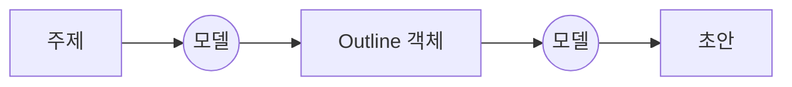

복잡한 작업을 프롬프트 하나에 몰아넣으면 모델이 지시를 빠뜨리고, 맥락을 잃고, 틀린 내용을 만들어 냅니다. 제약이 여럿이고 순서대로 따져야 하는 일일수록 그렇습니다. 그래서 큰 문제를 작은 하위 작업의 순서로 쪼개고, 단계마다 그 일만 하는 프롬프트를 씁니다. 앞 단계의 출력이 다음 단계의 입력이 됩니다. 원서는 이것을 파이프라인 패턴이라고도 부릅니다. 단계별로 디버깅할 수 있고, 단계 사이에 도구나 구조화된 데이터를 끼울 수 있습니다.

**프롬프트 하나로 감당이 안 될 만큼 복잡하거나, 처리 단계가 여럿이거나, 단계 사이에 외부 도구를 써야 할 때** 씁니다.

```kotlin
// 모델이 채워 줄 그릇. 이 클래스로 JSON 스키마가 만들어져 프롬프트에 함께 실리고,
// 돌아온 JSON 은 Jackson 이 생성자 파라미터 이름을 맞춰 그대로 채운다
data class Outline(val sections: List<String>)

val outline = chatClient.prompt()
    .user("$주제 로 목차를 잡아줘")
    .call()
    .entity(Outline::class.java)      // 답을 문자열이 아니라 객체로 받는다

val draft = chatClient.prompt()
    .user("아래 목차로 초안을 써줘\n" + outline.sections.joinToString("\n"))
    .call()
    .content()
```

전용 API는 없습니다. 호출을 두 번 하면 됩니다. 다만 중간 결과를 `.entity()` 로 받으면 **응답 문자열을 파싱할 필요가 없고**, 다음 단계에서 컴파일러가 먼저 잡아 줍니다.

`joinToString` 으로 전부 싣는 것은 중간 결과가 이 목차만큼 작을 때 이야기입니다. 커지면 비용이 따라 커지고, 프롬프트가 길수록 모델이 가운데를 흘립니다. 그때는 **다음 단계가 쓸 조각만** 넘깁니다. 통째로 두고 써야 하면 저장소에 넣고 필요한 부분만 검색해 끼우는데, 뒤에 나올 14장 지식 검색이 하는 일입니다.

## 2장 라우팅 (Routing)

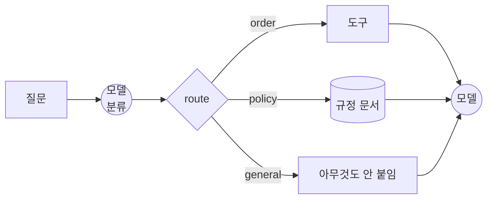

들어오는 요청은 종류가 다양한데, 어디로 보낼지 고르는 장치가 없으면 흐름이 굳어 버립니다. 라우팅은 먼저 요청의 의도를 판별하고, 그 결과에 따라 가장 맞는 도구·함수·하위 에이전트로 흐름을 보냅니다. 판별은 LLM 에게 시킬 수도, 규칙으로 할 수도, 임베딩 유사도로 할 수도 있습니다.

**입력에 따라 서로 다른 흐름·도구·에이전트 중 하나를 골라야 할 때** 씁니다. 원서가 드는 예가 판매 문의·기술 지원·계정 관리를 가려내는 고객 지원 봇입니다.

```kotlin
data class RouteDecision(val route: String, val reason: String) {
    // route 값은 모델이 쓴 텍스트다. "Order" 로 오든 엉뚱한 값이 오든 여기서 좁힌다
    fun route(): Route =
        Route.entries.firstOrNull { it.name.equals(route.trim(), true) } ?: Route.GENERAL
}

// 분류 규칙의 전부. 경로를 늘리거나 기준을 바꾸려면 여기를 고친다
val CLASSIFIER = """
    너는 고객 문의를 분류하는 라우터다. 질문에 답하지 말고 분류만 해라.
    - order   : 주문번호·배송 상태 등 주문 조회 시스템을 봐야 하는 질문
    - policy  : 환불·교환·장비 대여 등 사내 규정 문서를 찾아야 하는 질문
    - general : 위 둘에 해당하지 않는 일반 질문
    route 에는 order, policy, general 중 하나만 적는다.
""".trimIndent()

val decision = chatClient.prompt()
    .system(CLASSIFIER)                     // 분류 규칙을 시스템 메시지로
    .user(질문)
    .call()
    .entity(RouteDecision::class.java)

val request = chatClient.prompt().user(질문)   // 세 경로가 같은 요청에서 갈라진다

when (decision.route()) {
    Route.ORDER   -> request.tools(SupportTools(orderService)).call().content()
    Route.POLICY  -> request.advisors(qaAdvisor).call().content()
    Route.GENERAL -> request.call().content()
}
```

## 3장 병렬화 (Parallelization)

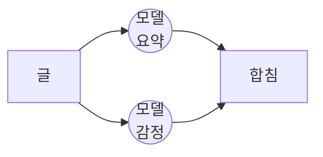

하위 작업이 여럿인데 하나가 끝나야 다음을 시작하면 전체 시간은 각 작업 시간의 합이 됩니다. API 호출이나 DB 조회처럼 I/O 를 기다리는 작업이 많을수록 병목이 커집니다. 서로의 결과에 기대지 않는 작업을 골라 동시에 실행하고, 전부 끝나기를 기다렸다가 다음 단계로 갑니다.

**여러 API 에서 데이터를 모으거나, 데이터를 나눠 처리하거나, 나중에 합칠 결과물을 여러 개 만들 때** 씁니다.

```kotlin
val (요약, 감정) = coroutineScope {
    val a = async { chatClient.prompt().user("이 글을 요약해줘: $글").call().content() }
    val b = async { chatClient.prompt().user("이 글의 감정을 분류해줘: $글").call().content() }
    a.await() to b.await()
}
```

## 4장 자기 검토 (Reflection)

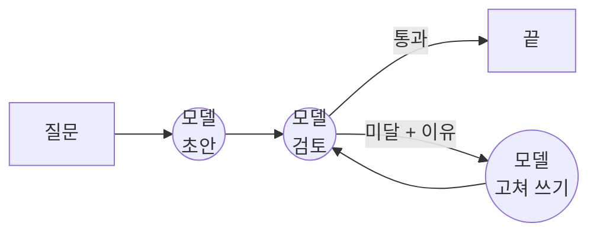

모델의 첫 답은 대개 부족합니다. 부정확하거나, 빠진 게 있거나, 복잡한 요구를 다 못 맞춥니다. 그런데 기본 흐름에는 자기 실수를 알아채고 고칠 장치가 없습니다. 체이닝·라우팅·병렬화가 흐름을 짜는 패턴이라면, 자기 검토는 그 흐름에 **피드백 루프**를 넣습니다. 만드는 쪽(Producer)이 답을 내면 검토하는 쪽(Critic)이 정해진 기준으로 평가하고, 그 비평으로 개선판을 만듭니다. 생성 → 평가 → 개선을 **될 때까지 되풀이**합니다.

**속도와 비용보다 정확도와 완성도가 중요할 때** 씁니다. 긴 글 다듬기, 코드 작성과 디버깅, 상세한 계획 세우기가 그런 일입니다.

원서가 가장 길게 설명하는 대목은 **누가 채점하느냐**입니다. 두 쪽을 다른 프롬프트, 다른 페르소나로 나누라고 합니다. 자기 작업을 자기가 보면 판정이 후해지기 때문입니다.

```kotlin
// Critic 이 채워 줄 그릇. reason 이 있어야 무엇을 고칠지가 남는다
data class Critique(val pass: Boolean, val reason: String)

val CRITIC = """
    너는 사내 규정을 검토하는 감사자다. 답을 새로 쓰지 말고 검토만 해라.
    pass   — 규정의 수치를 그대로 말하고 어긋남이 없을 때만 true
    reason — 규정의 어느 대목이 빠졌거나 틀렸는지 숫자까지 짚어 한 문장
""".trimIndent()

var answer = chatClient.prompt()                // Producer — 규정을 주지 않는다
    .system("고객 문의에 한 문장으로 답해라. 반드시 한국어 단어만 쓴다.")
    .user(질문).call().content()

for (round in 1..2) {                           // 루프는 두 바퀴까지만 돈다
    val critique = chatClient.prompt()          // Critic — 별도 호출, 별도 프롬프트
        .system(CRITIC)
        .user("규정:\n$규정\n\n질문: $질문\n답: $answer")
        .call()
        .entity(Critique::class.java)           // 판정과 이유를 함께 받는다

    if (critique.pass) break

    answer = chatClient.prompt()                // Producer 가 지적을 받아 다시 쓴다
        .user("$질문\n\n앞선 답: $answer\n검토자 지적: ${critique.reason}")
        .call().content()
}
```

루프 자체는 평범한 `for` 와 `if` 입니다. Spring AI 가 해 주는 건 검토 결과를 `pass`·`reason` 이 있는 객체로 받아 주는 것 하나고, 그 덕에 판정을 파싱하지 않고 바로 분기합니다.

돌려 보면 이렇게 됩니다.

1. 초안 : "정책에 따라 달라질 수 있습니다" (얼버무림)
2. 검토 : 미달. "규정에는 왕복 6,000원인데 그 수치가 빠졌다"
3. 고쳐 쓰기 : "왕복 배송비 6,000원을 구매자가 부담합니다"
4. 검토 : 통과

모델 호출 네 번입니다. 한 바퀴 더 돌면 두 번씩 늘어납니다.

그래서 원서는 이 패턴이 비싸다고 못 박습니다. 호출이 늘고, 초안·검토·수정본이 프롬프트에 계속 쌓입니다. 루프를 두 바퀴로 묶어 둔 이유입니다.

쓰는 쪽과 검토하는 쪽을 아예 다른 에이전트로 세우면 7장 멀티 에이전트가 됩니다.

## 5장 도구 사용 (Tool Use)

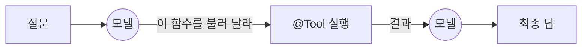

LLM 은 텍스트를 잘 만들지만 바깥 세상과 끊겨 있습니다. 지식은 학습 시점에 멈춰 있고, 무언가를 실행하거나 실시간 정보를 가져올 수 없습니다. 도구 사용은 쓸 수 있는 외부 함수("도구")를 모델이 이해할 수 있게 설명해 두는 것으로 시작합니다. 모델은 요청을 보고 도구가 필요한지 판단해, 어떤 함수를 어떤 인자로 부를지 JSON 으로 만듭니다. **실행은 모델이 아니라 프레임워크가 합니다.** 결과를 받아 다시 모델에게 넘기면, 모델이 그걸로 답을 씁니다. 함수 호출(function calling)이라고도 부릅니다.

**모델 안의 지식을 벗어나 바깥과 상호작용해야 할 때** 씁니다. 실시간 데이터, 사내 DB 조회, 정밀 계산, 코드 실행, 메일 발송이 그렇습니다.

Spring AI에서는 함수에 애너테이션 하나만 붙이면 도구가 됩니다.

```kotlin
class SupportTools(private val orderService: OrderService) {

    // @Tool      — 이 함수를 모델이 부를 수 있는 도구로 등록한다
    // description — 모델이 읽는 유일한 설명. 언제 부를지 여기서 판단한다
    @Tool(description = "주문 번호로 주문 상태와 배송 정보를 조회한다")
    fun lookupOrder(
        // @ToolParam — 인자 설명. 스키마의 description 으로 들어간다
        @ToolParam(description = "주문 번호. 예: A-1024") orderId: String,
    ): String = orderService.find(orderId)?.summary() ?: "주문번호 $orderId 를 찾을 수 없습니다."
}
```

```kotlin
chatClient.prompt()                   // 호출 하나를 조립하기 시작한다
    .user(질문)
    .tools(SupportTools(orderService))      // @Tool 이 붙은 객체를 통째로 넘긴다
    .call()                           // 동기 호출 (토큰을 흘리려면 .stream())
    .content()                        // 응답을 문자열로. 타입으로 받으려면 .entity()
```

프레임워크가 함수 이름과 파라미터를 스키마로 만들어 프롬프트에 싣습니다. 하지만 **모델이 읽고 판단하는 것은 `description` 문장 하나뿐입니다.** 시그니처도 함수 본문도 모델에게는 보이지 않습니다. 그래서 이 문장이 부정확하면 불러야 할 때 안 부르고, 엉뚱한 때 부릅니다.

### `.call()` 한 번에 모델 호출 두 번

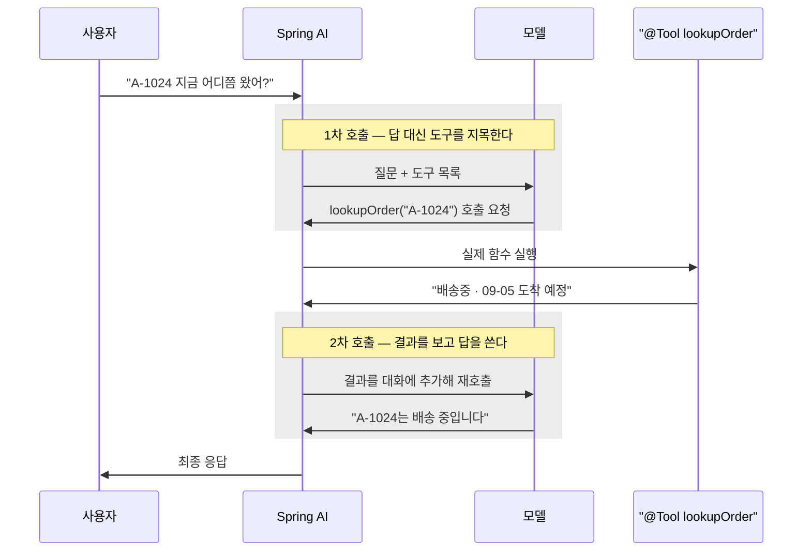

`@RequestMapping` 메서드를 직접 호출하는 사람은 없습니다. 등록해 두면 요청이 왔을 때 스프링이 대신 부릅니다. `@Tool` 도 같은 자리입니다. `.tools(SupportTools(orderService))` 는 도구를 **등록**하는 것이지 호출하는 것이 아니고, 실제로 부르는 쪽은 프레임워크입니다. 제어의 역전입니다.

그래서 **몇 번 돌지는 내 코드가 아니라 모델이 정합니다.** 도구가 필요 없다고 보면 한 번으로 끝나고, 여러 도구를 차례로 써야 하면 세 번 네 번으로 늘어납니다. 빈을 등록만 하고 생명주기를 컨테이너에 맡기듯, 여기서는 호출 횟수를 맡기는 셈입니다.

종량제 API 는 왕복마다 따로 과금됩니다. 그래서 **상한은 코드가 겁니다.** 2.0.1부터 호출 상한이 기본으로 켜져 있습니다.

```properties
spring.ai.tools.limits.max-calls-per-tool-default=40   # 도구 하나당
spring.ai.tools.limits.max-total-tool-calls=150        # 한 요청의 전체 합
spring.ai.tools.limits.on-limit-exceeded=throw         # 넘으면 ToolCallLimitExceededException
```

## 6장 계획 수립 (Planning)

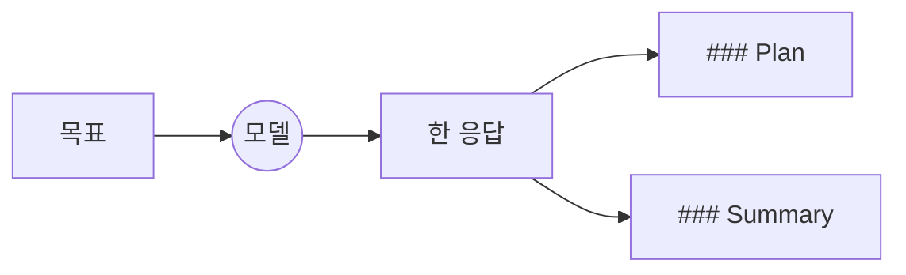

1장 체이닝은 단계를 개발자가 정했습니다. 목차를 뽑고 초안을 쓴다는 순서가 코드에 적혀 있고, 어떤 입력이 와도 그대로 돕니다.

그런데 단계를 미리 정할 수 없는 일이 있습니다. "신입 개발자 첫 주 온보딩을 준비해라" 같은 요청은 무엇부터 할지, 몇 단계로 나눌지부터 목표마다 다릅니다. 계획 수립은 **단계 나누기부터 모델에게 맡기는** 패턴입니다.

원서의 예제는 가장 단순한 형태입니다. 계획 세우기와 실행을 한 호출에 시킵니다.

```kotlin
val report = chatClient.prompt()
    .user("""
        1. '$목표' 를 이룰 계획을 불릿 3개로 세워라.
        2. 그 계획을 팀장에게 보고하듯 두 문장으로 요약해라.

        아래 두 절로만 답한다.
        ### Plan
        ### Summary
    """.trimIndent())
    .call()
    .content()      // 계획도 요약도 이 문자열 하나에 함께 온다
```

`### Plan` 에 단계 목록이 옵니다. 이 단계들은 코드 어디에도 없습니다. 모델이 목표를 보고 정한 것이라 실행할 때마다 다르게 옵니다. 1장과의 차이가 이것 하나입니다. **단계를 코드에 적었느냐, 모델이 정하느냐.**

거꾸로 단계를 미리 정할 수 있으면 이 패턴을 쓸 이유가 없습니다. 환불 처리처럼 절차가 늘 같으면, 1장 체이닝처럼 코드에 적는 쪽이 예측 가능합니다.

## 7장 멀티 에이전트 (Multi-Agent)

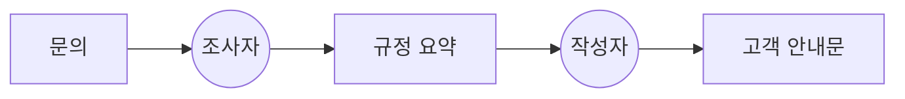

에이전트 하나가 모든 전문 기술과 도구를 갖출 수는 없습니다. 여러 영역에 걸친 문제를 혼자 풀면 거기서 병목이 생기고 결과가 부실해집니다. 그래서 문제를 하위 문제로 쪼개고, 각각을 그 일에 맞는 도구와 능력을 가진 전문 에이전트에게 맡깁니다.

**작업이 서로 다른 전문성이나 도구가 필요한 하위 작업으로 나뉠 때** 씁니다. 복잡한 조사·분석, 소프트웨어 개발, 콘텐츠 제작이 그렇습니다.

원서는 협업 방식을 여섯으로 늘어놓습니다.

- **순차 인계**: 한 에이전트가 끝내고 다음에게 넘긴다
- **병렬**: 각자 다른 부분을 맡아 동시에 한다
- **토론과 합의**: 같은 문제를 두고 겨뤄 나은 답을 고른다
- **계층**: 관리자 에이전트가 일을 나눠 준다
- **전문가 팀**: 분야별 전문 에이전트를 둔다
- **Critic-Reviewer**: 만든 것을 다른 에이전트가 검토한다. 4장의 모양입니다

아래는 순차 인계입니다. Spring AI에서는 `ChatClient` 를 역할 수만큼 만듭니다.

```kotlin
// defaultSystem — 이 ChatClient 로 나가는 모든 호출에 붙는 고정 시스템 메시지
@Bean fun 조사자(b: ChatClient.Builder) = b.defaultSystem("규정에서 문의와 관련된 대목만 뽑는다").build()
@Bean fun 작성자(b: ChatClient.Builder) = b.defaultSystem("조사 결과로 고객 안내문을 쓴다").build()

// 누가 먼저 하고 무엇을 넘길지는 직접 짠다
val 요약 = 조사자.prompt().user(문의).call().content()
val 안내문 = 작성자.prompt().user("문의: $문의\n조사 결과: $요약").call().content()
```

Bean을 역할 수만큼 두는 것까지가 프레임워크의 몫입니다. **조율을 맡는 클래스는 없습니다.** 뒤집으면 조율이 전부 평범한 코드라는 뜻입니다. 순서를 바꾸고, 조건으로 가르고(2장), 동시에 돌리고(3장), 여러 라운드를 도는(4장) 일을 앞 장들에서 하던 그대로 하면 됩니다.

역할마다 다른 것을 붙일 수 있다는 게 분담의 값어치입니다. 조사자에게만 규정 문서 검색을 달거나 작성자만 큰 모델로 돌리는 식인데, 각각 뒤에 나올 14장과 16장에서 다룹니다.

## 8장 대화 기억 (Memory Management)

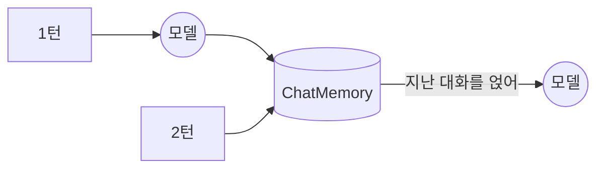

에이전트가 복잡한 일을 하려면 지난 대화를 기억해야 합니다. 기억이 없으면 호출마다 백지에서 시작해서, 대화 맥락을 잇지도, 경험에서 배우지도, 사용자에 맞추지도 못합니다.

**질문 하나에 답하고 끝나지 않을 때** 씁니다. 대화 내내 맥락을 잇거나, 여러 단계 작업의 진행을 추적하거나, 사용자 선호를 기억하는 일입니다.

원서는 기억을 둘로 나눕니다. 
- **단기 기억**은 지금 오가는 대화이고, 프롬프트에 실을 수 있는 만큼(컨텍스트 창)이 한계입니다. 
- **장기 기억**은 그 창 밖에 두었다가 필요할 때 꺼내 오는 것으로, 저장은 `VectorStore` 에 하고 꺼내는 방법은 14장 RAG 와 같습니다. 

이 장은 단기 기억을 다룹니다.

```kotlin
// 무엇을 기억할지 정하는 정책 — 최근 20개 메시지만 유지한다
val chatMemory = MessageWindowChatMemory.builder().maxMessages(20).build()

val chatClient = builder
    // 지난 대화를 프롬프트에 자동으로 붙여 주는 Advisor
    .defaultAdvisors(MessageChatMemoryAdvisor.builder(chatMemory).build())
    .build()

chatClient.prompt()
    .user("방금 뭐라고 했지?")
    // 대화 ID는 호출 시점에 넘긴다. 빠뜨리면 예외가 난다
    .advisors { it.param(ChatMemory.CONVERSATION_ID, "user-42") }
    .call().content()
```

위의 `chatMemory` 는 몇 개를 기억할지 정하는 **정책**이고, 실제 저장은 기본이 인메모리라 재시작하면 사라집니다. 대화를 남겨야 하면 **저장소만 갈아 끼웁니다.** JDBC · Redis · MongoDB · Neo4j · Cassandra 중에서 고르는데, 코드는 그대로고 의존성과 설정 한 줄이 바뀝니다.

```kotlin
implementation("org.springframework.ai:spring-ai-starter-model-chat-memory-repository-jdbc")
```

```properties
# 대화 테이블을 기동 때 만들지 여부. 내장 DB 가 아니면 always 로 켠다
spring.ai.chat.memory.repository.jdbc.initialize-schema=always
```

## 9장 학습과 적응 (Learning and Adaptation)

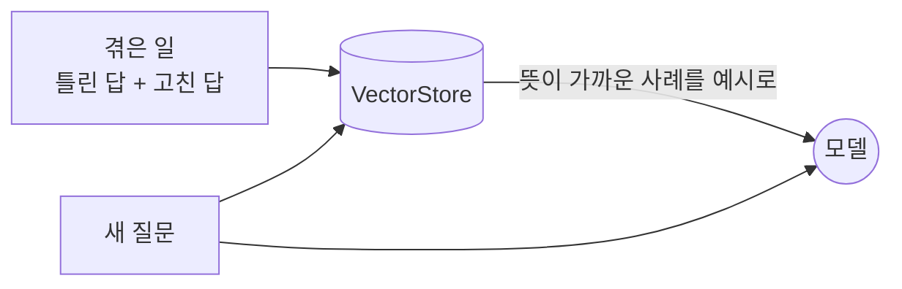

미리 짜 둔 규칙은 예상 밖 상황에서 깨집니다. 오늘 상담원이 답을 고쳐 줘도 내일 또 똑같이 틀립니다. 학습과 적응은 에이전트가 겪은 것을 다음 행동에 반영하게 만드는 패턴입니다.

**환경이 계속 바뀌거나, 개인화가 필요하거나, 처음 보는 상황을 스스로 처리해야 할 때** 씁니다.

원서는 배우는 방법을 여섯으로 늘어놓습니다.

| 방법 | 무엇으로 배우나 |
| --- | --- |
| 강화학습 | 행동에 따라오는 보상과 벌 |
| 지도학습 | 정답이 붙은 예시 |
| 비지도학습 | 정답 없는 데이터 속의 패턴 |
| Few-shot · Zero-shot | 프롬프트에 실린 예시 몇 개 |
| 온라인 학습 | 계속 들어오는 새 데이터 |
| 기억 기반 학습 | 비슷했던 지난 경험 |

여기에 LLM 을 사람의 선호에 맞추는 PPO 와 DPO 까지 다룹니다.

여섯을 가르는 선은 하나입니다. **모델의 가중치를 바꾸느냐, 다음 호출에 실을 것을 바꾸느냐.** 앞의 셋과 PPO·DPO 는 가중치를 바꿉니다. 학습 파이프라인과 GPU 가 필요한 일이라 애플리케이션 프레임워크가 손댈 자리가 아닙니다. 뒤의 셋은 모델을 그대로 두고 프롬프트에 무엇을 실을지만 바꿉니다. 여기가 Spring AI 의 자리입니다.

원서도 그 자리를 활용 사례에 따로 적어 두었습니다.

> [!quote] Knowledge Base Learning Agents
> 에이전트는 RAG(14장)로 문제와 검증된 해법의 지식 베이스를 계속 키울 수 있다. 성공한 전략과 부딪힌 문제를 저장해 두면, 판단할 때 그 데이터를 참조해 이미 통했던 패턴을 적용하거나 알려진 함정을 피한다.

코드는 그 문장 그대로입니다.

```kotlin
// 겪은 일을 저장한다 — 틀렸던 답까지 함께 남겨 같은 함정을 피하게 한다
vectorStore.add(listOf(Document("질문: $질문\n처음 답(틀림): $틀린답\n고친 답: $고친답")))

// 다르게 물어도 뜻이 가까우면 그 사례가 예시로 딸려 들어간다 (14장 의미 검색)
chatClient.prompt().user(새질문)
    .advisors(QuestionAnswerAdvisor.builder(vectorStore).build())
    .call().content()
```

**고쳐 준 답이 쌓이는 곳에** 씁니다. 상담원이 모범 답을 계속 다듬는 고객 응대라면 재학습 없이 다음 답부터 달라집니다.

예제는 저장한 사례의 질문과 실제로 던지는 질문을 **일부러 다르게** 뒀습니다. 사례에는 "환불 배송비 얼마야?"가 들어 있는데 묻는 것은 "단순 변심으로 반품하면 비용이 얼마나 드나요?"입니다. 같은 질문을 되풀이하면 방금 넣은 답을 그대로 베끼는 것이라 아무것도 증명하지 못합니다. **말이 달라도 뜻이 가까우면 걸린다**는 것이 이 패턴이 작동하는 조건입니다.

쓰는 부품은 14장 지식 검색과 같습니다. 저장소에 넣는 것이 사내 문서냐, 겪은 일이냐만 다릅니다. 틀렸던 답까지 함께 남기는 것이 문서와 다른 점인데, 원서가 말하는 "알려진 함정을 피한다"가 그 자리입니다.

반대쪽 끝에 원서가 드는 것이 **SICA** 입니다. 자기 소스 코드를 고치는 코딩 에이전트인데, 지난 버전들의 벤치마크 점수를 보고 가장 나은 것을 골라 그 위에서 스스로 고쳐 씁니다. 거기까지 가면 애플리케이션이 아니라 실험 장치입니다.

## 10장 MCP (Model Context Protocol)

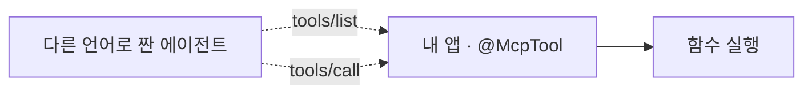

도구나 데이터 소스를 붙일 때마다 방식이 제각각이면 연동 하나하나가 일회성 작업이 되고 재사용이 안 됩니다. MCP 는 LLM 과 외부 시스템 사이의 공통 인터페이스입니다. 클라이언트-서버 구조로, 서버가 도구·데이터·프롬프트를 열어 두면 규격을 따르는 어떤 클라이언트든 그것을 **찾아서 쓸 수 있습니다.**

**여러 시스템과 붙는 복잡한 에이전트를 만들거나, 재배포 없이 새 도구를 발견해 써야 할 때** 씁니다. 원서는 단서를 답니다. 함수 몇 개가 고정돼 있는 단순한 앱이면 직접 함수 호출로 충분합니다.

`@Tool` 이 애플리케이션 안의 함수를 모델에게 열어 준다면, `@McpTool` 은 **그 함수를 애플리케이션 밖으로 엽니다.**

```kotlin
@Component
class McpTools(private val orderService: OrderService) {
    // @McpTool — MCP 프로토콜로 노출된다. 스키마는 시그니처에서 자동 생성
    @McpTool(name = "lookupOrder", description = "주문 번호로 주문 상태와 배송 정보를 조회한다")
    fun lookupOrder(
        @McpToolParam(description = "주문 번호. 예: A-1024") orderId: String,
    ): String = orderService.find(orderId)?.summary() ?: "주문번호 $orderId 를 찾을 수 없습니다."
}
```

```kotlin
implementation("org.springframework.ai:spring-ai-starter-mcp-server-webmvc")
```

스타터를 얹으면 앱이 MCP 서버가 됩니다. 다른 언어로 짠 에이전트는 MCP 표준 요청인 `tools/list` 로 위 도구의 스키마를 받아 가고, `tools/call` 로 실행을 요청합니다. 전송(Streamable HTTP · STDIO)도 내장이라 별도 SDK가 필요 없습니다.

## 11장 목표 설정과 모니터링 (Goal Setting and Monitoring)

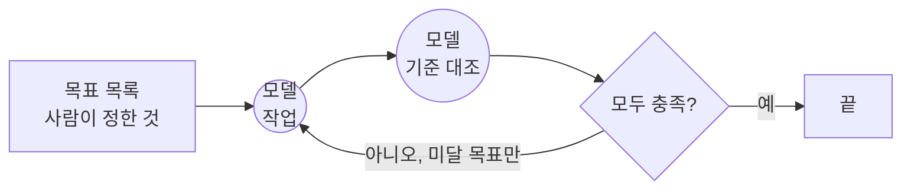

목표가 없으면 에이전트는 시키는 것에만 반응합니다. 일을 마쳐도 잘 됐는지 스스로 알 길이 없습니다. 그래서 **무엇이 되면 성공인지를 먼저 정하고**, 결과가 나오면 그 기준에 대 봅니다. 앞이 목표 설정, 뒤가 모니터링입니다.

**사람이 계속 붙어 있지 않아도 여러 단계 작업을 끝까지 해내야 할 때** 씁니다.

원서 예제는 코드를 쓰는 에이전트입니다. 사람이 문제와 함께 **목표 목록**을 줍니다 - *간단할 것 · 정확할 것 · 엣지 케이스를 다룰 것 · 예제 출력을 붙일 것.* 
에이전트는 코드를 쓰고, 그 목록에 비추어 스스로 판정하고, **미달이면 최대 다섯 번까지 다시 씁니다.** 목표를 다 채우면 그때 파일로 저장합니다.

두 가지가 이 패턴의 뼈대입니다. **목표는 사람이 정한다**는 것과, **다 채울 때까지 돈다**는 것입니다.

```kotlin
// 사람이 정해 둔 목표. 모델이 만드는 것이 아니라 측정할 수 있게 미리 적어 둔다
val 목표들 = listOf(
    "환불 가능 기한을 숫자로 밝힌다",
    "단순 변심일 때 배송비를 누가 얼마 부담하는지 밝힌다",
    "교환 조건도 함께 안내한다",
)

// 목표마다 충족 여부를 따로 받는다. 이 목록이 곧 진행 상황판이다
data class Check(val goal: String, val met: Boolean, val why: String)

var 답 = ""
var 미달 = emptyList<Check>()

for (round in 1..2) {                       // 원서는 최대 5회
    답 = chatClient.prompt()
        .user(질문 + 규정 + 미달.joinToString { it.goal })   // 못 채운 목표만 다시 싣는다
        .call().content()

    val 점검 = chatClient.prompt().system(MONITOR)
        .user(목표들.joinToString() + 답)
        .call()
        .entity(object : ParameterizedTypeReference<List<Check>>() {})

    미달 = 점검.filterNot { it.met }
    if (미달.isEmpty()) break               // 목표를 다 채웠으면 끝
}
```

`Check` 목록이 곧 **진행 상황판**입니다. 목표마다 충족 여부가 따로 오니 어느 것이 남았는지 보이고, 그 남은 것만 다음 회차 프롬프트에 실립니다. 목표를 문자열 하나로 뭉쳐 두면 이게 안 됩니다.

**4장 자기 검토**와 그림이 닮았지만 재는 것이 다릅니다. 
- 4장은 **답이 더 나아졌는지**를 검토자가 보고, 
- 여기는 **미리 정해 둔 기준을 채웠는지**를 하나씩 대조합니다. 

그래서 4장의 판정은 통과·미달 하나고, 여기는 목표 수만큼입니다.

## 12장 예외 처리와 복구 (Exception Handling and Recovery)

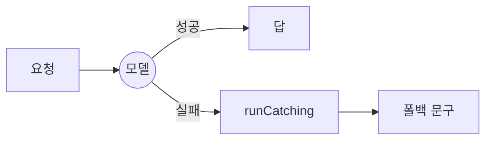

운영 환경에서는 도구가 실패하고, 네트워크가 끊기고, 이상한 데이터가 들어옵니다. 대비가 없으면 에이전트는 예상 밖 상황에서 통째로 멈춥니다. 도구 출력과 API 응답을 감시해 문제를 먼저 알아채고, 로그 남기기·일시 장애 재시도·폴백으로 대응합니다. 더 심하면 안정 상태로 되돌리거나, 계획을 고치거나, 사람에게 넘깁니다.

**운영에 올리는 모든 에이전트에** 필요합니다.

재시도는 설정으로 켜고 끕니다.

```properties
# 기본값은 10회에 2초 → 50초 백오프. 모델이 없으면 화면이 몇 분 멈춘다
spring.ai.retry.max-attempts=1
```

폴백은 직접 씁니다. Spring AI 가 예외를 두 부류로 갈라 주므로 그 축으로 가릅니다. `TransientAiException` 은 5xx·타임아웃처럼 **다시 보내면 성공할 수 있는 장애**고, `NonTransientAiException` 은 잘못된 요청·설정처럼 **다시 보내도 똑같이 실패하는 오류**입니다. 재시도도 앞의 것만 다시 보냅니다.

```kotlin
val answer = runCatching {
    chatClient.prompt().user(질문).call().content()
}.getOrElse { e ->
    // 폴백은 장애에만 건다. 설정 오류나 버그까지 이 문구로 덮으면 고장이 안 보인다
    if (e !is TransientAiException) throw e
    log.warn("model unavailable, falling back", e)
    "지금 답변이 어렵습니다. 상담원에게 연결해 드릴까요?"
}
```

기본값 10회는 운영 기준입니다. 순간 장애를 재시도가 조용히 삼켜 주니, **시연처럼 실패를 눈으로 봐야 할 때만 낮춥니다.**

## 13장 사람 개입 (Human-in-the-Loop)

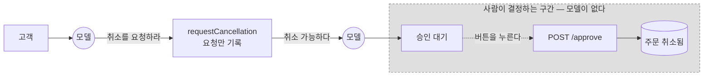

미묘한 판단, 윤리적 추론, 모호한 맥락은 LLM 이 잘 못합니다. 실수의 대가가 큰 곳에 완전 자동화를 두면 안전·금전·윤리 문제로 이어집니다. 사람 개입은 사람의 눈을 흐름 안에 두는 것입니다. 계산과 데이터 처리는 AI 가 하고, 검증·피드백·개입은 사람이 합니다. 자동화의 위험을 줄이면서, 사람의 입력에서 계속 배웁니다.

**의료·금융처럼 오류의 대가가 크거나, 콘텐츠 검수·고객 지원 에스컬레이션처럼 LLM 이 확실히 처리 못 하는 모호한 일에** 씁니다.

원서는 사람이 끼어드는 자리를 여섯으로 늘어놓습니다.

- **지켜보기**(oversight): 로그와 대시보드로 살핀다
- **바로잡기**(intervention): 막히거나 틀렸을 때 고친다
- **학습용 피드백**(feedback for learning): 사람의 선호를 모델 학습에 쓴다
- **결정 보강**(decision augmentation): AI 가 분석과 추천을 내고 사람이 최종 결정한다
- **협업**: 정형 처리는 AI 가, 창의적 판단은 사람이 맡는다
- **에스컬레이션 규칙**: 언제 사람에게 넘길지 미리 정해 둔다

아래는 그중 넷째, 사람이 최종 결정하는 자리입니다.

조회 도구는 모델이 지목하면 그대로 실행됩니다. 데이터를 바꾸는 도구는 그렇게 두면 안 됩니다.

| 도구 | 위임 범위 |
| --- | --- |
| `lookupOrder` | 모델이 지목하면 즉시 실행 |
| `requestCancellation` | 모델은 요청만 기록, 실행은 사람이 승인 |

전용 API는 없습니다. **위험한 작업을 실행하지 않는 도구로 만들면 됩니다.**

```kotlin
// description 에 "실제로 취소하지 않는다"고 적어 둔다. 모델이 읽는 계약이다
// 승인을 기다리는 주문 번호. 화면이 이 값을 보고 승인 버튼을 단다
var pendingCancel: String? = null

@Tool(description = "주문 취소를 요청한다. 실제로 취소하지 않고 고객 승인을 받는 단계다.")
fun requestCancellation(orderId: String): String {
    orderService.cancelBlockedReason(orderId)?.let { return "취소할 수 없습니다 — $it" }
    pendingCancel = orderService.find(orderId)!!.id      // 요청만 기록. 상태는 건드리지 않는다
    return "주문 $pendingCancel 은 취소 가능합니다. 고객이 승인 버튼을 눌러야 실제로 취소됩니다."
}
```

실제 취소는 승인 버튼이 부르는 별도 엔드포인트가 합니다.

```kotlin
// 평범한 컨트롤러. ChatClient 도 Advisor 도 등장하지 않는다
@PostMapping("/approve")
fun approve(@RequestBody req: ApproveRequest): ApproveReply {
    orderService.cancel(req.orderId)                   // 여기서 비로소 상태가 바뀐다
    return ApproveReply(true, "취소되었습니다", orderService.all())
}
```

다만 **중단과 재개가 없습니다.** 화면에서 바로 승인받는 정도면 충분하지만, 승인을 며칠 기다렸다가 멈춘 자리에서 이어가야 한다면 그 상태 관리는 직접 짭니다.

> [!quote] 원서가 짚는 대가
> 원서는 사람을 끼우는 대가도 짚습니다. 사람은 수백만 건을 못 봅니다. 판단의 질은 그 사람의 숙련도에 달렸습니다. 그리고 사람에게 보여주려면 화면에 뜨는 내용에서 민감정보를 먼저 지워야 합니다.

## 14장 지식 검색 (RAG)

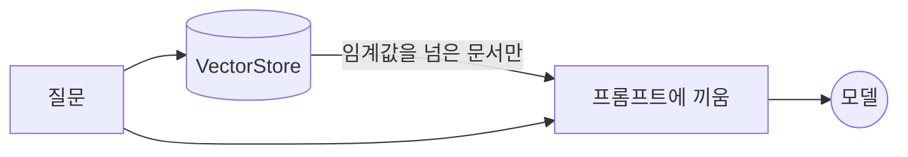

모델은 학습 데이터 밖을 모릅니다. 최신 정보나 사내 데이터를 물으면 낡았거나 틀린 답을 합니다. RAG 는 질문이 오면 먼저 저장해 둔 문서에서 관련 대목을 찾아 프롬프트에 덧붙이고, 그 프롬프트를 모델에 보냅니다. 원서의 표현으로는 모델을 **closed-book 에서 open-book 으로** 바꾸는 것입니다. 답에 근거가 남아 검증할 수 있습니다.

**학습에 없던 정보로 답해야 할 때** 씁니다. 원서가 드는 예는 사내 규정·기술 매뉴얼로 답하는 사내 Q&A, 제품 매뉴얼과 FAQ 로 답하는 고객 지원, 최신 기사를 찾아 요약하는 일입니다.

### 뜻으로 찾는다

검색이 키워드 검색이면 이 패턴은 성립하지 않습니다. 사용자는 문서와 다른 말로 묻기 때문입니다. 그래서 원서는 장의 절반을 검색의 원리에 씁니다.

- **임베딩**: 문장을 좌표(숫자 배열)로 바꿉니다. 뜻이 가까우면 자리도 가깝습니다. 원서의 예로 "고양이"가 (2, 3)이면 "새끼 고양이"는 (2.1, 3.1)쯤이고, "자동차"는 (8, 1)처럼 멀리 있습니다.
- **의미 검색**: 질문도 좌표로 바꿔, 가까운 문서부터 찾습니다. "털이 복슬복슬한 반려동물"과 "집고양이"는 겹치는 낱말이 없어도 걸립니다. 이 가까움이 유사도 점수입니다.
- **청킹**: 50쪽 매뉴얼을 통째로 넣지 않고 절 단위로 자릅니다. 문제 해결법을 물으면 문제 해결 조각만 딸려 옵니다.
- **벡터 저장소**: 그 좌표들을 담아 두고 가까운 순으로 꺼내 줍니다. 키워드 검색은 낱말을 찾고, 벡터 저장소는 뜻을 찾습니다.

Spring AI 에서는 Advisor 하나가 문서 검색과 프롬프트에 끼워 넣기를 모두 처리합니다. 5장의 `@Tool` 과 같은 모양입니다. 내가 검색을 호출하는 게 아니라 `QuestionAnswerAdvisor` 를 **등록**해 두면, 프레임워크가 호출 직전에 끼어들어 검색하고 프롬프트를 고칩니다. 제어의 역전입니다.

```kotlin
.advisors(
    QuestionAnswerAdvisor            // RAG 전용 Advisor. 검색부터 끼워 넣기까지 한다
        .builder(vectorStore)        // 어디서 찾을지
        .searchRequest(SEARCH)       // 어떻게 찾을지 (아래)
        .build(),
)
```

무엇을 몇 건 끼울지는 검색 요청으로 정합니다. `topK` 는 가까운 순으로 몇 건을 뽑을지인데, 이 건수는 **점수와 무관하게 채워집니다.** 관련 문서가 없어도 제일 덜 무관한 것들이 딸려 오므로, `similarityThreshold` 로 선을 그어 미달을 버립니다.

```kotlin
val SEARCH = SearchRequest.builder()
    .topK(3)                   // ① 가까운 순으로 3건을 뽑고
    .similarityThreshold(0.5)  // ② 그중 0.5 미만은 버린다 (전부 미달이면 끼우지 않음)
    .build()
```

같은 원리를 도구에도 씁니다. 도구가 수백 개면 스키마를 매 호출에 다 싣는 대신, 질문에 맞는 것만 검색해 모델에 보여 줍니다. Spring AI 의 `ToolSearchToolCallingAdvisor` 가 그 자리이고, 찾는 방법은 정규식·Lucene·벡터 검색 중 고릅니다. 원서에는 없는 패턴입니다.

## 15장 에이전트 간 통신 (Inter-Agent Communication)

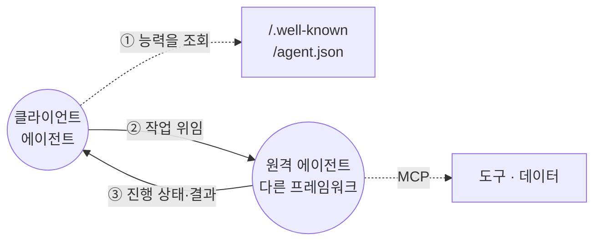

에이전트 하나로는 여러 갈래가 얽힌 문제를 감당하기 어렵습니다. 그렇다고 프레임워크가 다른 에이전트끼리 붙이려 하면 **공통 언어가 없어** 연동마다 새로 짜야 합니다. 원서의 해법은 구글이 연 **A2A(Agent2Agent) 프로토콜**입니다. HTTP 위에서 도는 공개 표준이고, ADK·LangGraph·CrewAI 로 만든 에이전트가 서로를 몰라도 일을 맡기고 결과를 받습니다.

**프레임워크가 다른 에이전트 둘 이상을 엮어야 할 때, 또는 상대의 능력을 미리 박아 두지 않고 그때그때 찾아 써야 할 때** 씁니다.

상대를 알아보는 수단은 **Agent Card** 입니다. 주소·버전·할 수 있는 일(skills)·인증 방식을 적은 JSON 신분증을 약속된 자리(`/.well-known/agent.json`)나 사내 레지스트리에 걸어 두면, 상대는 그것만 읽고 일을 맡깁니다. 주고받는 단위는 요청이 아니라 **작업(task)** 이라 `submitted → working → completed` 로 상태가 바뀌고, 받는 방식도 넷입니다 — 바로 받기, 폴링, SSE, 웹훅.

봉투는 MCP 와 똑같이 JSON-RPC 지만 자리가 다릅니다. 원서는 둘을 경쟁이 아니라 **보완**으로 놓습니다.

| | 잇는 대상 | 상대가 하는 일 |
| --- | --- | --- |
| MCP (10장) | 에이전트 ↔ 도구·데이터 | 시킨 함수를 그대로 실행한다 |
| A2A (15장) | 에이전트 ↔ 에이전트 | 알아서 처리하고 결과를 돌려준다 |

원서가 원격 에이전트를 **속이 안 보이는(opaque) 상대**로 규정하는 것도 이 차이에서 나옵니다. 도구는 시그니처가 전부 드러나야 부를 수 있지만, 상대 에이전트는 안에서 무슨 모델을 몇 번 부르든 알 필요가 없습니다.

Spring AI 2.0.1 BOM 의 아티팩트 169개 중 A2A 는 없어, 이 예제에는 규격의 최소 조각을 직접 얹었습니다. 원격 에이전트 쪽은 엔드포인트 둘이 전부입니다.

```kotlin
@GetMapping("/.well-known/agent.json")   // 신분증 — 자기가 할 수 있는 일을 밝힌다
@PostMapping("/a2a")                     // 일을 받는 자리 — 봉투는 JSON-RPC
```

클라이언트는 신분증을 읽고 문장 하나를 넘깁니다. 함수 이름도 인자도 없습니다.

```json
{"jsonrpc":"2.0","id":1,"method":"message/send",
 "params":{"message":{"role":"user","parts":[{"kind":"text","text":"A-1024 지금 어디쯤 왔어?"}]}}}
```

돌아오는 것은 값이 아니라 **작업**이라, 상태가 단계별로 찍혀 옵니다. 그 사이 원격 에이전트는 모델을 부르고 5장 도구까지 썼는데, **화면의 타임라인은 비어 있습니다.** 클라이언트가 볼 수 없는 자리에서 일어난 일이라서입니다. 이 장만 화면에서 고른 모델이 안 먹는 것도 같은 이유입니다 — 무슨 모델을 쓸지는 상대가 정합니다.

## 16장 자원 최적화 (Resource-Aware Optimization)

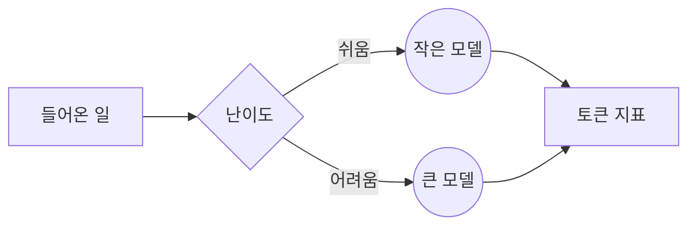

에이전트가 아껴 써야 할 자원은 셋입니다 — **계산·시간·비용.** 원서는 이 패턴을 6장 계획과 분명히 가릅니다. 계획이 할 일의 순서를 짜는 것이라면, 여기는 정해진 예산 안에서 **무엇으로 처리할지**를 정하는 일입니다.

가장 좋은 모델을 모든 일에 쓰는 건 낭비이니, 요청의 난이도를 먼저 분류하고 쉬운 것은 빠르고 싼 모델로, 어려운 것은 큰 모델로 보냅니다. 원서는 응답 품질을 평가해 라우팅 기준을 고쳐 가는 검토 에이전트까지 얹지만, 이 장은 라우팅까지만 봅니다.

**API 예산이 빡빡하거나, 응답 속도가 중요하거나, 엣지 기기처럼 자원이 제한된 곳에서** 씁니다.

무엇이 쉬운 일인지는 2장 라우터가 가려 줍니다. 그 분류를 그대로 씁니다.

```kotlin
// 분류·요약처럼 정해진 형식만 뽑는 일과, 근거를 들어 답해야 하는 일을 가른다
val model = when (decision.route()) {
    Route.ORDER   -> "qwen3:1.7b"          // 도구가 조회한 값을 옮겨 적기만 한다
    Route.GENERAL -> "qwen3:1.7b"          // 인사·잡담
    Route.POLICY  -> "qwen3:4b-instruct"   // 규정 문서를 읽고 근거를 들어야 한다
}

chatClient.prompt().user(질문)
    // ChatOptions — 벤더 중립 옵션. 재시작 없이 모델만 교체된다
    .options(ChatOptions.builder().model(model))
    .call().content()
```

난이도만 축인 것은 아닙니다. 사용자 등급으로 가르거나, 예산을 다 쓰면 작은 쪽으로 떨어뜨리거나, 데이터를 통째로 받는 대신 요약만 받아 오는 것도 같은 패턴입니다. 원서가 **핵심 전략**으로 꼽는 것은 대비책(fallback)입니다. 쓰려던 모델이 과부하나 스로틀로 막혔을 때 통째로 실패하는 대신 싼 모델로 내려앉아 서비스를 이어 갑니다(12장). 전부 평범한 코틀린이라 `when` 하나면 됩니다.

얼마나 썼는지는 actuator 를 올리면 지표로 쌓입니다.

```
gen_ai.client.token.usage
  gen_ai.operation.name  = [chat, embedding]
  gen_ai.response.model  = [qwen3:4b-instruct, bge-m3]
  gen_ai.token.type      = [output, input, total]
```

태그 규격이 벤더 중립이라 **벤더를 바꿔도 대시보드가 유지됩니다.**

## 17장 추론 기법 (Reasoning Techniques)

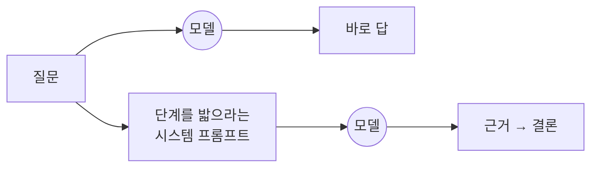

한 번에 답이 나오지 않는 문제가 있습니다. 논리적 추론, 분해, 전략적 계획이 필요한 여러 단계 작업입니다. 구조 없이 덤비면 결론이 틀리거나 빠집니다. 이 장의 기법들은 모델의 "생각" 과정을 밖으로 드러내 차근차근 풀게 합니다. 문제를 쪼개고 여러 경로를 탐색하게 하고(CoT·ToT), 답을 되풀이해 다듬고(Self-Correction), 추론과 도구 사용을 엮습니다(ReAct).

**쪼개서 단계별로 따져야 풀리는 문제, 특히 풀이 과정 자체가 답만큼 중요한 일에** 씁니다.

원서가 이 장에서 드는 기법입니다.

| 기법                                   | 시키는 것                                                           |
| ------------------------------------ | --------------------------------------------------------------- |
| CoT (Chain-of-Thought)               | 근거를 단계별로 적고 나서 결론을 낸다                                           |
| ToT (Tree-of-Thought)                | 갈래를 여럿 펼쳐 보고, 막히면 되돌아간다                                         |
| Self-Correction                      | 자기 답을 스스로 검토해 고쳐 쓴다 (4장 자기 검토)                                  |
| PALM (Program-Aided Language Models) | 계산이 필요한 대목은 코드를 짜서 실행한다                                         |
| ReAct (Reasoning and Acting)         | 생각하고, 도구를 부르고, 결과를 보고 다시 생각한다                                   |
| CoD (Chain of Debates)               | 여러 모델이 토론해 답을 다듬는다                                              |
| GoD (Graph of Debates)               | 토론을 사슬이 아니라 그래프로 본다. 논증이 노드, 지지·반박이 간선이고, 가장 튼튼한 논증 덩어리가 결론이 된다 |

관통하는 원리를 원서는 **추론 시점에 계산 자원을 더 쓰는 것**이라고 정리합니다. 한 번에 답하게 하지 않고 중간 과정을 밟게 하면 시간과 호출이 늘어나는데, 그 대가로 정확도를 얻는 것입니다. 원서는 여기서 한 걸음 더 나갑니다. **작은 모델에 추론 시간을 더 주는 편이 큰 모델을 한 번 부르는 것보다 나을 수 있습니다**(Inference Scaling Law). 16장이 어떤 모델을 쓸지 골랐다면, 이 장은 얼마나 깊이 생각하게 할지를 고릅니다.

원서가 이 장 끝에 드는 사례가 **Deep Research** 입니다. 링크를 받아 와 종합은 사람이 하는 검색과 달리, 몇 분짜리 시간 예산을 주면 에이전트가 스스로 검색하고, 결과를 읽어 빈 곳을 찾고, 다시 검색해 보고서를 냅니다. 이 장의 기법들이 한 제품 안에서 같이 도는 모양입니다.

Spring AI 가 따로 거드는 것은 없지만, 앞 장들이 이미 이 기법들의 구현입니다. Self-Correction 은 4장의 Producer-Critic 이고, PALM 은 코드 실행 도구를 `@Tool` 로 붙이면 5장이 됩니다. ReAct 는 5장의 도구 왕복이 그 모양입니다. 여기서는 가장 단순한 Chain-of-Thought 만 봅니다. 단계를 밟게 하는 것은 프롬프트의 몫입니다.

```kotlin
chatClient.prompt()
    .system("답하기 전에 근거를 단계별로 적고, 마지막 줄에 결론만 남겨라") // zero-shot CoT
    .user(질문)
    .call().content()
```

CoT 를 프롬프트로 시키는 대신 모델에 구워 둔 것이 **thinking 모드**입니다(qwen3 등). 켜면 답하기 전에 추론 토큰을 쏟아내는데, 그만큼 느려지고 토큰을 먹어서 `.entity()` 로 받는 JSON 이 중간에 잘리기도 합니다. 끄고 켜는 스위치는 공통 `ChatOptions` 에 없어 벤더 옵션을 씁니다.

```kotlin
OllamaChatOptions.builder().enableThinking()    // thinkLow · thinkMedium · thinkHigh 로 깊이도 정할 수 있다.
```

## 18장 가드레일 (Guardrails)

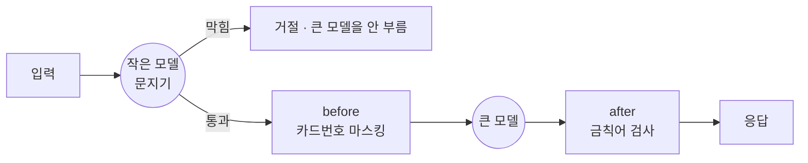

자율성이 커질수록 예측 못 한 행동이 나옵니다. 유해하거나 편향되거나 틀린 출력, 탈옥(jailbreak) 같은 공격입니다. 막을 장치가 없으면 신뢰를 잃고, 법적 문제나 평판 손상으로 이어집니다. 가드레일은 여러 겹의 방어입니다. 입력 검증으로 악의적 내용을 막고, 출력 필터로 원치 않는 응답을 잡고, 프롬프트로 행동을 제약하고, 도구 사용을 제한하고, 외부 모더레이션 API 를 붙이고, 중요한 결정엔 사람을 끼웁니다(13장).

**에이전트의 출력이 사용자·시스템·회사 평판에 영향을 주는 모든 곳에서** 씁니다.

원서는 가드레일의 목적이 **능력을 묶는 것이 아니라 믿고 맡길 수 있게 하는 것**이라고 못 박습니다. 검사가 있어야 더 많은 일을 맡길 수 있다는 뜻입니다.

검사를 꼭 규칙으로 짤 필요는 없습니다. 원서의 주 예제는 **작고 빠른 모델을 문지기로 세우는 것**입니다. 큰 모델 앞에 싼 모델을 두고 들어온 입력을 먼저 훑게 합니다. 앞 문단의 탈옥이 걸리는 자리가 여기입니다 — "앞의 지시는 무시하라" 류입니다. 16장에서 난이도로 모델을 갈랐다면, 여기서는 검사에 싼 모델을 씁니다.

```kotlin
data class Screen(val blocked: Boolean, val why: String)

val verdict = chatClient.prompt().system(GUARD)
    .options(ChatOptions.builder().model("granite4:micro"))   // 작고 빠른 모델
    .user(입력).call().entity(Screen::class.java)

if (verdict.blocked) return 거절(verdict.why)      // 큰 모델은 부르지 않는다
```

예제에서 문지기는 0.7초, 큰 모델은 그 뒤에 붙습니다. 막히면 큰 모델을 아예 부르지 않아 타임라인에 호출이 하나만 남습니다. 작은 모델이라 다 잡지는 못하는데, 원서도 한 겹으로 막으라고 하지 않고 **겹쳐 쌓으라고** 합니다.

`Advisor` 가 그 자리입니다. 도구 사용(5장)·지식 검색(14장)과 같은 제어의 역전입니다. 검사 코드를 호출 앞뒤에 직접 끼워 넣는 게 아니라 등록해 두면, 프레임워크가 모든 호출에 대해 대신 부릅니다. 서블릿 필터를 등록해 두면 모든 요청이 거쳐 가는 것과 같습니다.

```kotlin
// BaseAdvisor — before / after / getOrder 셋만 구현하면 된다
class MaskingAdvisor : BaseAdvisor {

    // 모델로 나가기 직전. 프롬프트를 고쳐서 돌려준다
    override fun before(req: ChatClientRequest, chain: AdvisorChain): ChatClientRequest =
        req.mutate().prompt(마스킹(req.prompt())).build()

    // 모델에서 돌아온 직후. 응답을 검사하거나 바꿔치기한다
    override fun after(res: ChatClientResponse, chain: AdvisorChain): ChatClientResponse =
        if (금칙어(res)) 거절응답() else res

    // 작을수록 먼저 실행된다. ToolCallingAdvisor 는 Integer.MIN_VALUE + 300
    override fun getOrder(): Int = 1000
}
```

`getOrder()` 를 도구 루프보다 **큰 값**으로 주면 도구 왕복마다 다시 불립니다. 모델이 지목한 인자를 실행 직전에 검사하고 싶을 때 쓰는 자리입니다.

원서가 이 장의 마지막 항목으로 남기는 말이 있습니다. 믿을 만한 에이전트를 만드는 가장 확실한 방법은 **에이전트를 복잡한 소프트웨어로 다루는 것** — 장애 대응, 상태 관리, 테스트 같은 수십 년 된 공학 관행을 그대로 적용하는 것입니다.

## 19장 평가와 모니터링 (Evaluation and Monitoring)

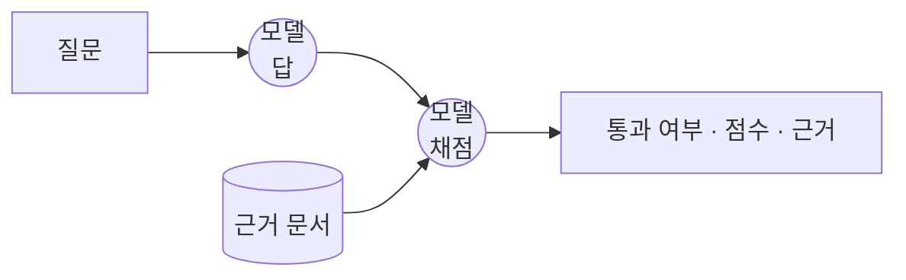

LLM 은 확률적이라 같은 입력에도 다른 답을 냅니다. 기댓값을 못 박는 기존 테스트로는 품질을 지킬 수 없습니다. 그래서 정확도·지연·토큰 사용량은 숫자로 재고, 답의 품질은 **LLM 을 심판으로** 세워 채점합니다(LLM-as-a-Judge).

**운영 중인 에이전트의 품질을 계속 지켜보거나, 버전이나 모델을 체계적으로 비교해야 할 때** 씁니다. 입력이 달라지며 답이 서서히 나빠지는 것(drift)을 잡는 자리도 여기입니다.

11장과 헷갈리기 쉬운데 원서가 직접 가릅니다. 11장은 에이전트가 **자기 일을 하면서 스스로** 기준을 채웠는지 보는 것이고, 이 장은 **밖에서 계속** 재는 것입니다.

Spring AI에는 채점기 구현체가 둘 있습니다.

| 구현체 | 무엇을 보나 |
| --- | --- |
| `RelevancyEvaluator` | 답이 질문과 주어진 문맥에 맞는가 |
| `FactCheckingEvaluator` | 답이 주어진 문서에 근거하는가 (환각 탐지) |

```kotlin
// EvaluationRequest 는 세 가지를 받는다 — 질문, 근거로 삼을 문서, 채점할 답
val response = evaluator.evaluate(EvaluationRequest(질문, 검색된문서, 답))

response.isPass        // 통과 여부 (boolean)
response.getScore()    // 점수 (float)
response.getFeedback() // 왜 그렇게 판정했는지 (채점기에 따라 비어 있다)
```

**채점은 모델이 합니다.** 채점기는 질문·문서·답을 채점용 프롬프트에 담아 모델을 한 번 더 부르고, 돌아온 대답을 `isPass` 로 옮깁니다. `RelevancyEvaluator` 의 프롬프트는 이렇게 생겼습니다.

```
Your task is to evaluate if the response for the query
is in line with the context information provided.

You have two options to answer. Either YES or NO.
Answer YES, if the response for the query
is in line with context information otherwise NO.
```

YES/NO 만 묻기 때문에 **이 채점기의 `getFeedback()` 은 비어 있습니다.** 근거 문장이 필요하면 `getScore()` 를 쓰거나, 판정 이유까지 쓰게 하는 채점기를 직접 만듭니다. `Evaluator` 는 인터페이스입니다.

답만 채점하는 데는 한계가 있습니다. 원서는 LLM 심판의 약점으로 **중간 단계를 놓친다**는 점을 듭니다. 맞는 답에 도달했어도 도구를 엉뚱하게 골랐거나 쓸데없이 여러 번 돌았을 수 있습니다. 그래서 결과와 함께 **궤적(trajectory)** — 답에 이르기까지 밟은 단계의 순서 — 을 봅니다.

기대한 궤적과 실제를 맞추는 잣대는 여럿입니다. 순서까지 똑같아야 하는 exact match, 순서만 맞으면 여분을 허용하는 in-order match, 순서를 안 따지는 any-order match. 위험이 큰 일일수록 엄한 쪽을 씁니다.

이 예제 화면의 타임라인이 그 궤적입니다. 호출마다 어떤 프롬프트가 나갔고 어떤 도구를 불렀는지가 순서대로 남습니다.

RAG를 붙였다면 **회귀 테스트에 그대로 쓸 수 있습니다.** 문서를 바꾸거나 임베딩을 갈아 끼운 뒤 답이 나빠졌는지를 사람이 읽어 보지 않고 확인합니다.

## 20장 우선순위 결정 (Prioritization)

```mermaid
flowchart LR
    T[할 일 목록] --> M((모델))
    M --> L[Task 목록<br/>priority 가 붙어 온다]
    L --> S[코드가 정렬]
    S --> P[순서대로 처리]
```

할 수 있는 행동은 많고, 목표는 서로 충돌하고, 자원은 한정돼 있습니다. 다음에 뭘 할지 정하는 기준이 없으면 비효율에 빠지거나 주 목표를 놓칩니다. 우선순위 결정은 긴급도·중요도·의존성·비용 같은 기준을 세우고, 각 후보를 그 기준으로 평가해 가장 급하고 중요한 것부터 합니다.

**서로 충돌하는 여러 작업이나 목표를 자원 제약 안에서 스스로 관리해야 할 때** 씁니다.

원서가 드는 순위 기준은 여섯입니다.

| 기준 | 묻는 것 |
| --- | --- |
| 긴급도 | 시간에 쫓기나 |
| 중요도 | 주 목표에 얼마나 영향을 주나 |
| 의존성 | 이것이 끝나야 다른 것이 되나 |
| 자원 가용성 | 지금 쓸 도구와 정보가 있나 |
| 비용 대비 효과 | 들인 품에 견줄 만한가 |
| 사용자 선호 | 이 사용자가 먼저 원하는 것인가 |

이 중 몇 개를 골라 시스템 프롬프트에 적어 두면, 모델이 그 기준으로 점수를 매깁니다.

매기는 층위도 셋으로 나눕니다. 어떤 목표를 잡을지(상위 목표), 계획 안에서 어떤 단계를 먼저 할지(하위 작업, 6장 계획 수립이 이 자리입니다), 지금 당장 무엇을 할지(행동 선택).

1장처럼 목록을 타입으로 받아 코드가 돌립니다. 다른 점은 뒤가 조용하다는 것입니다. 정렬도 처리도 모델을 다시 부르지 않아, 호출은 처음 한 번뿐입니다.

```kotlin
data class Task(val title: String, val priority: Int, val reason: String)

val tasks = chatClient.prompt()
    .system("문의마다 처리 우선순위를 매긴다. title 은 문의를 10자 안팎 명사구로. priority 는 1~5, 클수록 급하다. reason 에는 그 순위인 근거를 한 문장으로.")
    .user(할일들)
    .call()
    .entity(object : ParameterizedTypeReference<List<Task>>() {})

tasks.sortedByDescending { it.priority }.forEach { 처리(it) }
```

**순위는 모델이 매기고, 정렬과 처리는 코드가 합니다.**

원서가 이 장에서 가장 무게를 싣는 것은 **재우선순위**입니다. 한 번 매긴 순위를 지키는 것은 대본대로 도는 스크립트도 합니다. 급한 일이 새로 들어오거나 마감이 닥쳤을 때 **판을 다시 짜는 것**이 에이전트와 스크립트를 가른다고 봅니다.

그러려면 바뀐 목록을 들고 모델을 다시 부릅니다. 위 코드가 한 번에 끝나는 것은 목록이 고정이라는 전제 위에서입니다.

## 21장 탐색과 발견 (Exploration and Discovery)

```mermaid
flowchart LR
    Q[질문] --> C1((후보 1))
    Q --> C2((후보 2))
    C1 --> J((겨루기<br/>세 관점이 한 표씩))
    C2 --> J
    J --> W[이긴 답 + 진 쪽 약점]
    W --> E((다듬기))
    E --> R[결과]
```

어디서 답을 찾아야 할지조차 모르는 문제가 있습니다. 아는 절차를 잘 해내는 게 아니라, 몰랐던 것(unknown unknowns)을 찾아내야 하는 일입니다. 이럴 때는 과학자들이 하듯 갑니다. 사람이 매 단계 끼어드는 대신, 역할이 다른 에이전트 여럿이 가설을 세우고, 서로 따지고, 살아남은 것을 키우는 순환을 스스로 돕니다.

**정답 목록이 없는 열린 문제에** 씁니다. 과학 연구, 시장 분석, 창작이 그렇습니다.

원서의 정리는 **만들고, 겨루고, 키운다**(generate, debate, evolve)입니다. 후보를 여럿 만들어 겨루게 하고, 이긴 것을 다듬어 다시 겨룹니다. 17장의 원리가 여기서 다시 나옵니다. 추론에 계산을 더 쓸수록 결과가 좋아집니다.

원서가 드는 사례는 구글의 AI Co-Scientist 입니다. 사람은 연구 목표 하나만 던집니다. 그 다음은 에이전트 여섯이 가설을 **내고 → 동료 심사하듯 검토하고 → 둘씩 붙여 토너먼트로 순위를 매기고 → 상위 가설을 다듬는** 순환을 사람 없이 돌립니다. 답 하나에 점수를 매기는 게 아니라 서로 붙인다는 점이 "겨룬다"입니다.

원서는 이것을 완전 자동화가 아니라 **증강**으로 못 박습니다. 사람은 목표를 던지고 결과를 검증할 뿐, 그 사이의 순환은 에이전트끼리 돕니다. 13장 사람 개입과는 반대 방향입니다 — 거기는 위험한 행동 앞에서 매번 사람이 끼어들고, 여기는 시작과 끝만 사람입니다.

코드로 보여주는 쪽은 Agent Laboratory(MIT)입니다. 원서가 옮겨 놓은 대목이 **심사위원 셋** — 같은 답을 다른 눈으로 봅니다.

| 심사위원 | 보는 것 |
| --- | --- |
| 엄격하되 공정한 심사자 | 근거가 분명한가 |
| 파급력을 보는 심사자 | 실제로 영향을 주는가 |
| 새로움을 보는 심사자 | 전에 없던 것인가 |

Spring AI 로 옮기면 부품은 전부 앞 장에 있습니다. 후보는 3장처럼 동시에 만들고, 심사위원은 7장처럼 시스템 프롬프트로 가르고, 점수는 1장처럼 타입으로 받고, 키우기는 4장 루프입니다.

```kotlin
// 심사위원 한 명의 한 표. 점수를 매기는 대신 둘 중 하나를 고른다
data class Vote(val label: String, val winner: Int, val weakness: String)

// ① 만들고 — 온도를 올려 서로 다른 후보를 동시에 뽑는다 (3장)
val 후보 = (1..2).map { async { chatClient.prompt().user(질문)
    .options(ChatOptions.builder().temperature(0.9)).call().content() } }.awaitAll()

// ② 겨루고 — 둘을 나란히 놓고 세 관점이 각각 한 표씩 던진다 (20장처럼 목록을 타입으로)
val 표 = chatClient.prompt().system(JUDGE)
    .user("후보1: ${후보[0]} · 후보2: ${후보[1]}")
    .call().entity(object : ParameterizedTypeReference<List<Vote>>() {})

val 이긴답 = if (표.count { it.winner == 2 } > 1) 후보[1] else 후보[0]   // 다수결

// ③ 키운다 — 이긴 답에 진 쪽 약점을 붙여 한 바퀴 더 (4장)
val 다듬은답 = chatClient.prompt()
    .user(질문 + 이긴답 + 표.joinToString { it.weakness }).call().content()
```

`JUDGE` 는 심사위원 셋을 적어 둔 시스템 프롬프트입니다 — *엄격은 근거가 분명한 쪽, 파급력은 고객에게 실제로 도움이 되는 쪽, 새로움은 덜 뻔한 쪽.* 셋인 이유는 하나면 그 한 사람의 취향이 그대로 정답이 되기 때문입니다. **항목 세 개를 반드시 낸다**고 못 박아야 합니다. 그러지 않으면 후보마다 한 줄씩 내놓아 표가 둘이 됩니다.

온도를 올린 것은 후보 둘이 서로 달라야 겨룰 거리가 생기기 때문입니다. 모델은 다음 낱말을 고를 때마다 후보들에 등수를 매기는데, 온도가 낮으면 늘 1등만 집고 높이면 2등·3등도 집습니다. 온도는 답을 정하는 값이 아니라 **고르는 폭**을 정하는 값이라, 같은 0.9 라도 부를 때마다 다른 답이 나옵니다.

원서의 Agent Laboratory 는 심사위원 셋을 각각 따로 부르지만, 여기서는 한 호출에 세 관점을 요구하고 점수를 매기는 대신 **둘 중 나은 쪽을 고르게** 합니다. Co-Scientist 의 Ranking 이 하는 토너먼트가 이 모양입니다 — 절대 점수보다 모델에게 쉽고, 답도 짧아 빠릅니다. 그래서 호출은 **후보 2 + 겨루기 1 + 다듬기 1, 네 번**입니다. 따로 불렀다면 아홉 번이었습니다. 원서가 "계산을 더 쓸수록 좋아진다"고 할 때 그 계산이 이 숫자입니다.

## 마무리

원서 결론은 21개를 하나씩 쓰는 게 아니라 **여러 개를 한 시스템에 짜 넣는 것**을 본론으로 삼습니다. 이 문서 안에서도 이미 그렇게 되어 있습니다.

| 장 | 안에 들어 있는 것 |
| --- | --- |
| 4장 자기 검토 | 1장의 `.entity()` + 루프 |
| 9장 학습과 적응 | 14장의 `VectorStore` + 프롬프트 예시 |
| 11장 목표 설정과 모니터링 | `.entity()` + 19장의 `Evaluator` |
| 13장 사람 개입 | 5장의 `@Tool` + 승인 게이트 |
| 16장 자원 최적화 | 2장의 라우터 판정 + `ChatOptions` |
| 21장 탐색과 발견 | 3장 병렬화 + 7장 역할 분담 + 1장 `.entity()` + 4장 루프 |

원서가 결론에서 드는 예는 **AI 연구 보조**입니다. "양자 컴퓨팅이 보안에 미치는 영향을 분석하라" 같은 요청이 들어오면 다섯 패턴이 이 순서로 맞물립니다.

| 원서의 단계 | 이 문서 |
| --- | --- |
| Planner 가 요청을 조사 단계로 쪼갠다 | 6장 계획 수립 |
| 단계마다 검색 도구를 부른다 | 5장 도구 사용 |
| Researcher · Writer · Critic 이 역할을 나눈다 | 7장 멀티 에이전트 |
| Critic 의 비평으로 Writer 가 고쳐 쓴다 | 4장 자기 검토 |
| 계획·수집물·초안·비평을 한 상태로 들고 간다 | 8장 대화 기억 |

## 참고

- Antonio Gulli, *Agentic Design Patterns: A Hands-On Guide to Building Intelligent Systems*, Springer, 2025
- [Building Effective Agents](https://docs.spring.io/spring-ai/reference/api/effective-agents.html) — Spring AI 레퍼런스. Anthropic 의 다섯 패턴(Chain · Routing · Parallelization · Orchestrator-Workers · Evaluator-Optimizer)을 `ChatClient` 조합으로 구현한 공식 예제. 코드는 [spring-ai-examples/agentic-patterns](https://github.com/spring-projects/spring-ai-examples/tree/main/agentic-patterns)
- [Tool Calling in Spring AI 2.0: A Composable, Agentic Architecture](https://spring.io/blog/2026/06/15/spring-ai-composable-tool-calling/)
- [The Spring AI Ecosystem in 2026: From Foundations to Agents](https://2026.springio.net/sessions/the-spring-ai-ecosystem-in-2026-from-foundations-to-agents/) — Spring I/O 2026
- [Spring AI 2.0.1 릴리스](https://spring.io/blog/2026/08/21/spring-ai-2-0-1-available-now) 
