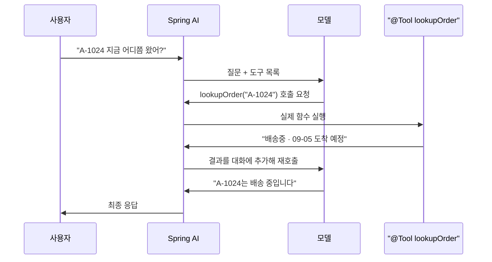

# Spring AI로 구현하는 에이전틱 패턴

LLM에 질문을 던지고 답을 받는 것만으로는 서비스가 되지 않습니다. 모델이 사내 시스템을 조회하고, 앞선 대화를 기억하고, 위험한 작업 앞에서는 멈춰야 합니다.

이런 구성 방식마다 붙은 이름이 **에이전틱 패턴**입니다. 이 문서는 *Agentic Design Patterns*(Antonio Gulli, Springer 2025)가 정리한 **21개 패턴을 원서 목차 순서 그대로** 놓고, 각각 Spring AI로 어떻게 쓰는지를 코드로 봅니다.

원서의 예제는 전부 파이썬(Google ADK · LangChain · CrewAI)이고 Spring AI는 한 번도 나오지 않습니다.

## 자주 나오는 이름 여섯 개

| 이름            | 무엇인가                                                   |
| ------------- | ------------------------------------------------------ |
| `ChatClient`  | 모델을 부르는 입구. 모든 호출이 여기를 지납니다. `prompt()…call()` 형태로 씁니다 |
| `Advisor`     | 그 호출 앞뒤에 끼우는 인터셉터. 서블릿 필터와 같은 자리입니다                    |
| `@Tool`       | 함수에 붙이면 모델이 부를 수 있는 도구가 됩니다                            |
| `.entity()`   | 응답을 문자열 대신 타입 객체로 받습니다(구조화 출력)                         |
| `VectorStore` | 문서를 벡터로 저장하고 의미가 가까운 것을 찾아 주는 저장소                      |
| `Evaluator`   | 모델의 답을 다시 모델로 채점합니다. 통과 여부·점수·근거를 돌려줍니다                |

- 예제 코드 — [demo-phase2](../../demo-phase2)
- Spring AI 기능별 설명 — [Spring AI 2.0 — 개념부터 에이전트까지](../phase1/Spring%20AI%202.0%20—%20개념부터%20에이전트까지.md)

## 21개 한눈에

| 장      | 패턴                               | 무엇으로 만드나                             |
| ------ | -------------------------------- | ------------------------------------ |
| 1 | [프롬프트 체이닝 (Prompt Chaining)](#1장-프롬프트-체이닝-prompt-chaining) | `.entity()` 로 중간 결과를 넘김 |
| 2 | [라우팅 (Routing)](#2장-라우팅-routing) | `.entity()` + `when` |
| 3 | [병렬화 (Parallelization)](#3장-병렬화-parallelization) | 코루틴 |
| 4 | [리플렉션 (Reflection)](#4장-리플렉션-reflection) | `Evaluator` + 재호출 |
| **5** | **[도구 사용 (Tool Use)](#5장-도구-사용-tool-use)** | **`@Tool`** |
| 6 | [계획 수립 (Planning)](#6장-계획-수립-planning) | `.entity()` + 순회 |
| 7 | [멀티 에이전트 (Multi-Agent)](#7장-멀티-에이전트-multi-agent) | `defaultSystem` 이 다른 `ChatClient` 여럿 |
| **8** | **[메모리 관리 (Memory Management)](#8장-메모리-관리-memory-management)** | **`ChatMemory`** + 저장소 6종 |
| 9 | [학습과 적응 (Learning and Adaptation)](#9장-학습과-적응-learning-and-adaptation) | `VectorStore` 에 축적 |
| **10** | **[MCP (Model Context Protocol)](#10장-mcp-model-context-protocol)** | **`@McpTool`** |
| 11 | [목표 설정과 모니터링 (Goal Setting and Monitoring)](#11장-목표-설정과-모니터링-goal-setting-and-monitoring) | `.entity()` + `Evaluator` |
| 12 | [예외 처리와 복구 (Exception Handling and Recovery)](#12장-예외-처리와-복구-exception-handling-and-recovery) | `spring.ai.retry` + 폴백 |
| 13 | [사람 개입 (Human-in-the-Loop)](#13장-사람-개입-human-in-the-loop) | 상태를 안 바꾸는 `@Tool` |
| **14** | **[지식 검색 (RAG)](#14장-지식-검색-rag)** | **`QuestionAnswerAdvisor`** |
| 15 | [에이전트 간 통신 (Inter-Agent Communication)](#15장-에이전트-간-통신-inter-agent-communication) | `@McpTool` 양방향 |
| 16 | [자원 인식 최적화 (Resource-Aware Optimization)](#16장-자원-인식-최적화-resource-aware-optimization) | `ChatOptions` + 지표 |
| 17 | [추론 기법 (Reasoning Techniques)](#17장-추론-기법-reasoning-techniques) | 시스템 프롬프트 |
| 18 | [가드레일 (Guardrails)](#18장-가드레일-guardrails) | `Advisor` |
| **19** | **[평가와 모니터링 (Evaluation and Monitoring)](#19장-평가와-모니터링-evaluation-and-monitoring)** | **`Evaluator`** |
| 20 | [우선순위 결정 (Prioritization)](#20장-우선순위-결정-prioritization) | `.entity()` + 정렬 |
| 21 | [탐색과 발견 (Exploration and Discovery)](#21장-탐색과-발견-exploration-and-discovery) | 병렬 생성 + `Evaluator` |

굵게 표시한 다섯만 그 패턴 전용 타입이 있습니다. 나머지 열여섯은 범용 기능을 조합하는데, 오른쪽 열에 같은 이름이 반복됩니다 — `.entity()` 다섯 번, `Evaluator` 네 번, `@Tool` 과 `@McpTool` 각각 두 번.

> [!info] 어디까지 확인한 것인가
> 클래스와 애너테이션은 `spring-ai` 2.0.1 아티팩트에서 확인했고, **21개 전부 예제 애플리케이션에서 실제로 돌려 봤습니다.** 화면에서 하나씩 눌러 실행하면 모델 호출이 몇 번 일어나는지 그대로 나옵니다.

## 1장 프롬프트 체이닝 (Prompt Chaining)

> [!quote] 부품
> `ChatClient` · `.entity()`

복잡한 작업을 프롬프트 하나에 몰아넣으면 모델이 지시를 빠뜨리거나 맥락을 잃습니다. 작업을 단계로 쪼개 한 번에 하나씩만 시키고, 앞 단계의 결과를 다음 프롬프트에 넣습니다. **한 프롬프트로 감당이 안 될 만큼 복잡하거나, 단계 사이에 외부 도구를 써야 할 때** 씁니다.

```kotlin
// 모델이 채워 줄 그릇. 이 클래스로 JSON 스키마가 만들어져 프롬프트에 함께 실린다
data class Outline(val sections: List<String>)

val outline = chatClient.prompt()
    .user("$주제 로 목차를 잡아줘")
    .call()
    .entity(Outline::class.java)      // 답을 문자열이 아니라 객체로 받는다

val draft = chatClient.prompt()
    .user("아래 목차로 초안을 써줘\n" + outline.sections.joinToString("\n"))
    .call()
    .content()
```

전용 API는 없습니다. 호출을 두 번 하면 됩니다. 다만 중간 결과를 `.entity()` 로 받으면 **응답 문자열을 파싱할 필요가 없고**, 다음 단계에서 컴파일러가 먼저 잡아 줍니다.

## 2장 라우팅 (Routing)

> [!quote] 부품
> `ChatClient` · `.entity()` — 분기는 평범한 `when`

들어오는 입력이 늘 같은 종류는 아닙니다. 순차 흐름 하나로는 상황에 따라 다르게 처리할 수 없습니다. 라우팅은 입력의 의도를 먼저 판별하고 거기에 맞는 경로로 흐름을 보냅니다. **판매 문의·기술 지원·계정 관리처럼 문의를 분류해 각각 다른 처리로 넘겨야 할 때** 씁니다.

```kotlin
data class RouteDecision(val route: String, val reason: String)

val decision = chatClient.prompt()
    .system(CLASSIFIER)                     // 분류 규칙을 시스템 메시지로
    .user(질문)
    .call()
    .entity(RouteDecision::class.java)

when (decision.route()) {                   // 여기부터는 평범한 코틀린
    Route.ORDER   -> request.tools(SupportTools(orders)).call().content()
    Route.POLICY  -> request.advisors(qaAdvisor).call().content()
    Route.GENERAL -> request.call().content()
}
```

`when` 이 평범한 코드라서 `@Transactional` 을 붙이거나 권한 검사를 넣거나 단위 테스트를 짜는 일이 평소와 똑같습니다.

> [!warning] 모델은 아무 문자열이나 넣을 수 있습니다
> 모델이 `route` 에 없는 값을 넣을 수 있습니다. 열거형으로 좁히고, 못 알아본 값은 가장 안전한 경로로 보냅니다.

라우팅에는 모델 호출이 한 번 더 듭니다. **건너뛰는 경로가 그 한 번보다 비쌀 때만 이득입니다.**

## 3장 병렬화 (Parallelization)

> [!quote] 부품
> `ChatClient` 뿐. 나머지는 코루틴이나 `CompletableFuture` 로 평소처럼 처리합니다

서로 기다릴 이유가 없는 작업까지 순서대로 돌리면 느려집니다. 독립적인 호출을 동시에 던져 전체 시간을 줄입니다. **여러 API에서 자료를 모으거나, 조각난 데이터를 각각 처리할 때** 씁니다.

```kotlin
val (요약, 감정) = coroutineScope {
    val a = async { chatClient.prompt().user("이 글을 요약해줘: $글").call().content() }
    val b = async { chatClient.prompt().user("이 글의 감정을 분류해줘: $글").call().content() }
    a.await() to b.await()
}
```

## 4장 리플렉션 (Reflection)

> [!quote] 부품
> `RelevancyEvaluator` · `EvaluationRequest` · `EvaluationResponse`

모델의 첫 답은 대개 부족합니다. 스스로 틀린 것을 알아채고 고칠 장치가 기본 흐름에는 없습니다. 리플렉션은 답을 낸 뒤 그 답을 다시 평가해 고쳐 쓰게 만듭니다. **속도와 비용보다 정확도와 완성도가 중요할 때** 씁니다.

```kotlin
// RelevancyEvaluator — 답이 질문·문맥에 맞는지 모델에게 되묻는 채점기
val evaluator = RelevancyEvaluator.builder()
    .chatClientBuilder(builder)      // 채점에도 모델을 쓴다. 작은 모델이면 충분
    .build()

var answer = chatClient.prompt().user(질문).call().content()

for (round in 1..2) {                // 최대 두 번까지만 고쳐 쓴다
    val verdict = evaluator.evaluate(EvaluationRequest(질문, 문서들, answer))
    if (verdict.isPass) break                    // isPass — 통과하면 더 부르지 않는다
    answer = chatClient.prompt()
        .user("$질문\n\n앞선 답은 이런 점이 부족했다: ${verdict.feedback}")
        .call().content()
}
```

`for` 와 `if` 는 직접 씁니다. 다만 **무엇을 기준으로 다시 쓸지**를 `Evaluator` 가 판정해 주므로, 재시도 조건이 프롬프트가 아니라 코드에 남습니다.

## 5장 도구 사용 (Tool Use)

> [!quote] 부품
> `@Tool` · `@ToolParam` · `ToolCallingAdvisor`

모델의 지식은 학습 시점에 멈춰 있고, 바깥 세상에 손을 뻗을 수도 없습니다. 도구 사용은 모델이 필요할 때 외부 함수를 부르게 해서 그 벽을 넘습니다. **실시간 데이터가 필요하거나 실제로 무언가를 실행해야 할 때** 씁니다.

Spring AI에서는 함수에 애너테이션 하나만 붙이면 도구가 됩니다.

```kotlin
// @Tool      — 이 함수를 모델이 부를 수 있는 도구로 등록한다
// description — 모델이 읽는 유일한 설명. 언제 부를지 여기서 판단한다
@Tool(description = "주문 번호로 주문 상태와 배송 정보를 조회한다")
fun lookupOrder(
    // @ToolParam — 인자 설명. 스키마의 description 으로 들어간다
    @ToolParam(description = "주문 번호. 예: A-1024") orderId: String,
): String = orders.find(orderId)?.summary() ?: "주문번호 $orderId 를 찾을 수 없습니다."
```

```kotlin
chatClient.prompt()                   // 호출 하나를 조립하기 시작한다
    .user(질문)
    .tools(SupportTools(orders))      // @Tool 이 붙은 객체를 통째로 넘긴다
    .call()                           // 동기 호출 (토큰을 흘리려면 .stream())
    .content()                        // 응답을 문자열로. 타입으로 받으려면 .entity()
```

프레임워크가 함수 이름과 파라미터를 스키마로 만들어 프롬프트에 싣습니다. 하지만 **모델이 읽고 판단하는 것은 `description` 문장 하나뿐입니다.** 시그니처도 함수 본문도 모델에게는 보이지 않습니다. 그래서 이 문장이 부정확하면 불러야 할 때 안 부르고, 엉뚱한 때 부릅니다.

### 왕복은 두 번이다



사용자는 한 번 물었는데 모델은 두 번 돕니다. 1차에서 모델은 답 대신 "이 함수를 이 인자로 불러 달라"고 하고, 런타임이 실제로 실행한 뒤, 결과를 붙여 2차로 다시 묻습니다.

**몇 번 돌지는 모델이 정합니다.** 도구가 필요 없다고 보면 한 번으로 끝나고, 여러 도구를 차례로 써야 하면 세 번 네 번으로 늘어납니다.

> [!warning] 비용이 요청 수에 비례하지 않습니다
> 종량제 API라면 청구도 그만큼 늘어납니다. 사용자 요청 수로 비용을 어림잡으면 빗나갑니다.
> 2.0.0까지는 `chatResponse().metadata.usage` 마저 왕복을 합산하지 않아 적게 잡혔습니다. 2.0.1에서 고쳐졌습니다.

다만 **천장은 코드가 쥡니다.** 2.0.1부터 호출 상한이 들어왔고, 아무것도 설정하지 않아도 켜져 있습니다.

```properties
spring.ai.tools.limits.max-calls-per-tool-default=40   # 도구 하나당
spring.ai.tools.limits.max-total-tool-calls=150        # 한 요청의 전체 합
spring.ai.tools.limits.on-limit-exceeded=throw         # 또는 return_error_response
```

넘으면 `ToolCallLimitExceededException` 이 납니다. `throw` 면 `ToolCallingAdvisor` 가 그것을 잡아 최종 응답으로 돌려주는데, **이미 실행된 도구 결과는 버리지 않고** `METADATA_PARTIAL_TOOL_RESPONSES` 에 담아 둡니다. `return_error_response` 면 남은 호출을 건너뛰고 "한도를 넘었다"는 응답을 만들어 모델에게 돌려주므로, 모델이 그 사실을 알고 대화를 잇습니다.

도구별로 따로 매기거나 아예 빼는 것도 됩니다.

```properties
spring.ai.tools.limits.max-calls-per-tool.search=10
spring.ai.tools.limits.excluded-tools=getCurrentWeather
```

**끝없이 도는 것을 막는 안전판이지, 비용을 재는 자는 아닙니다.** 기본값 40과 150은 정상적인 대화라면 닿지 않을 높이입니다. 여기에 걸렸다면 대개 모델이 같은 도구를 반복해서 부르는 상황입니다.

이 왕복을 도는 것이 `ToolCallingAdvisor` 입니다. Advisor 체인 위에 있어서 도구 실행 앞뒤에 다른 Advisor를 끼울 수 있습니다.

> [!warning] 요청에 없던 도구가 불릴 수 있습니다
> `spring.ai.tools.resolution.fallback.enabled` 를 켜면, 모델이 지목한 이름을 `.tools(...)` 로 넘긴 목록 밖에서도 찾아 실행합니다. 리졸버가 아는 도구가 전부 사정권에 들어옵니다. 기본값은 `false` 이고, 공식 문서도 완전히 통제할 수 있을 때만 켜라고 답니다.

> [!info] ToolSearch — 원서에 없는 패턴
> 도구가 수백 개가 되면 목록 전체를 프롬프트에 실을 수 없습니다. Spring AI 2.0의 `ToolSearch` 가 질문과 관련된 것만 골라 싣습니다. **원서 21개 어디에도 없는 패턴입니다.**

## 6장 계획 수립 (Planning)

> [!quote] 부품
> `.entity()` — 실행하는 `for` 문은 직접

복잡한 요청은 한 번의 행동으로 끝나지 않습니다. 계획 수립은 목표를 여러 단계로 나누고 순서를 정한 뒤 하나씩 실행합니다. **조사 보고서 작성이나 온보딩 절차처럼 여러 단계가 얽힌 일을 자동화할 때** 씁니다.

```kotlin
data class Plan(val steps: List<Step>)
data class Step(val order: Int, val instruction: String)

val plan = chatClient.prompt()
    .system(PLANNER)                     // "목표를 단계로 쪼개라"는 지시
    .user(목표)
    .call()
    .entity(Plan::class.java)

for (step in plan.steps.sortedBy { it.order }) {   // 실행은 여기서 직접
    chatClient.prompt().user(step.instruction).call().content()
}
```

**`for` 문이 곧 실행 엔진입니다.** 재시도, 단계 건너뛰기, 중간 실패 처리는 전부 여기에 씁니다.

## 7장 멀티 에이전트 (Multi-Agent)

> [!quote] 부품
> `ChatClient.Builder` · `defaultSystem()`

하나의 에이전트가 모든 전문성과 도구를 갖출 수는 없습니다. 역할을 나눠 각자 잘하는 부분을 맡기고 결과를 합칩니다. **작업이 성격이 다른 하위 작업으로 쪼개질 때** 씁니다.

Spring AI에서는 `ChatClient` 를 역할 수만큼 만듭니다.

```kotlin
// defaultSystem — 이 ChatClient 로 나가는 모든 호출에 붙는 고정 시스템 메시지
@Bean fun 작성자(b: ChatClient.Builder) = b.defaultSystem("너는 초안을 쓴다").build()
@Bean fun 검토자(b: ChatClient.Builder) = b.defaultSystem("너는 초안을 비판한다").build()

// 누가 먼저 말하고 몇 번 주고받을지는 직접 짠다
val draft  = 작성자.prompt().user(주제).call().content()
val review = 검토자.prompt().user(draft).call().content()
```

빈을 역할 수만큼 두는 것까지가 프레임워크의 몫입니다. **조율을 맡는 클래스는 없습니다.**

## 8장 메모리 관리 (Memory Management)

> [!quote] 부품
> `ChatMemory` · `MessageChatMemoryAdvisor` · `ChatMemoryRepository`

LLM은 호출마다 아무것도 기억하지 못합니다. 대화 맥락을 유지하려면 지난 메시지를 다시 넣어 줘야 합니다. **대화가 여러 턴 이어지거나, 여러 단계에 걸친 작업의 진행 상황을 추적해야 할 때** 씁니다.

```kotlin
val chatClient = builder
    // 지난 대화를 프롬프트에 자동으로 붙여 주는 Advisor
    .defaultAdvisors(MessageChatMemoryAdvisor.builder(chatMemory).build())
    .build()

chatClient.prompt()
    .user("방금 뭐라고 했지?")
    // 대화 ID는 호출 시점에 넘긴다. 빠뜨리면 예외가 난다
    .advisors { it.param(ChatMemory.CONVERSATION_ID, "user-42") }
    .call().content()
```

기본 구현은 메모리에만 담아서 재시작하면 사라집니다. 저장소는 **스타터로 갈아 끼웁니다** — JDBC · Redis · MongoDB · Neo4j · Cassandra.

```kotlin
implementation("org.springframework.ai:spring-ai-starter-model-chat-memory-repository-jdbc")
```

## 9장 학습과 적응 (Learning and Adaptation)

> [!quote] 부품
> `VectorStore` · `Document` · `QuestionAnswerAdvisor`

설계 시점에 예상하지 못한 상황에서는 미리 짜 둔 로직이 통하지 않습니다. 학습과 적응은 실제 사용에서 얻은 피드백을 반영해 거동을 개선합니다. **개인화가 필요하거나 환경이 계속 바뀌는 곳에서** 씁니다.

모델을 재학습시키는 게 아니라 **프롬프트에 넣을 예시를 쌓는 방식**입니다.

```kotlin
// 사람이 고쳐 준 좋은 답을 저장해 두고
vectorStore.add(listOf(Document("질문: $질문\n모범 답: $고친답")))

// 다음 질문에는 비슷한 사례가 예시로 딸려 들어간다
chatClient.prompt().user(새질문)
    .advisors(QuestionAnswerAdvisor.builder(vectorStore).build())
    .call().content()
```

뒤에 나올 14장 지식 검색과 부품이 똑같습니다. 저장소에 넣는 것이 사내 문서냐 지난 사례냐만 다릅니다.

## 10장 MCP (Model Context Protocol)

> [!quote] 부품
> `@McpTool` · `@McpToolParam`

모델과 외부 도구를 이을 때마다 매번 다른 방식으로 붙이면 재사용이 되지 않습니다. MCP는 도구와 데이터를 노출하는 표준 프로토콜을 정해, 서버가 내놓은 것을 어떤 클라이언트든 찾아 쓰게 합니다. **여러 시스템과 붙는 복잡한 에이전트를 만들 때** 씁니다.

`@Tool` 이 애플리케이션 안의 함수를 모델에게 열어 준다면, `@McpTool` 은 **그 함수를 애플리케이션 밖으로 엽니다.**

```kotlin
@Component
class McpTools(private val orders: OrderService) {
    // @McpTool — MCP 프로토콜로 노출된다. 스키마는 시그니처에서 자동 생성
    @McpTool(name = "lookupOrder", description = "주문 번호로 주문 상태와 배송 정보를 조회한다")
    fun lookupOrder(
        @McpToolParam(description = "주문 번호. 예: A-1024") orderId: String,
    ): String = orders.find(orderId)?.summary() ?: "주문번호 $orderId 를 찾을 수 없습니다."
}
```

이 선언만으로 다른 언어로 짠 에이전트가 `tools/list` 로 스키마를 받아 갑니다. 전송(Streamable HTTP · STDIO)도 내장이라 별도 SDK가 필요 없습니다.

## 11장 목표 설정과 모니터링 (Goal Setting and Monitoring)

> [!quote] 부품
> `.entity()` · `Evaluator`

목표가 없으면 에이전트는 시키는 것에만 반응합니다. 목표를 명시하고 달성 여부를 확인하는 장치를 붙이면 스스로 여러 단계를 밟아 나갑니다. **사람이 계속 붙어 있지 않아도 목표를 완수해야 할 때** 씁니다.

정의는 `.entity()`, 판정은 `Evaluator` 입니다.

```kotlin
data class Goal(val description: String, val successCriteria: String)

val goal = chatClient.prompt().system(GOAL_SETTER).user(요청)
    .call().entity(Goal::class.java)

// evaluator 는 4장에서 만든 것과 같다
// 작업 결과가 성공 기준을 만족하는지 코드가 판정한다
val done = evaluator
    .evaluate(EvaluationRequest(goal.successCriteria, 작업결과))
    .isPass
```

목표를 문자열로 두면 달성 여부를 사람이 읽어야 합니다. 타입으로 두면 **루프의 종료 조건**이 됩니다.

## 12장 예외 처리와 복구 (Exception Handling and Recovery)

> [!quote] 부품
> `spring.ai.retry` 프로퍼티

실제 환경에서는 도구가 실패하고 네트워크가 끊기고 이상한 입력이 들어옵니다. 그 상황을 감지해 복구 경로로 넘기는 것이 이 패턴입니다. **운영에 올리는 모든 에이전트에** 필요합니다.

재시도는 설정으로 켜고 끕니다.

```properties
# 기본값은 10회에 2초 → 50초 백오프. 모델이 없으면 화면이 몇 분 멈춘다
spring.ai.retry.max-attempts=1
```

폴백은 직접 씁니다.

```kotlin
val answer = runCatching {
    chatClient.prompt().user(질문).call().content()
}.getOrElse {
    "지금 답변이 어렵습니다. 상담원에게 연결해 드릴까요?"   // 폴백
}
```

기본값이 10회인 데는 이유가 있습니다. 관측이 목적이면 꺼 두고, **운영에서는 반대로 판단합니다.**

## 13장 사람 개입 (Human-in-the-Loop)

> [!quote] 부품
> `@Tool` · 그리고 LLM이 없는 평범한 `@PostMapping`

판단이 미묘하거나 실수의 대가가 큰 일을 모델에게 완전히 맡기는 것은 위험합니다. 사람 개입은 결정적인 지점에서 사람의 판단을 흐름에 끼웁니다. **의료·금융처럼 오류의 대가가 크거나, 모델이 확신하지 못하는 경계 사례에서** 씁니다.

조회 도구는 모델이 지목하면 그대로 실행됩니다. 데이터를 바꾸는 도구는 그렇게 두면 안 됩니다.

| 도구 | 위임 범위 |
| --- | --- |
| `lookupOrder` | 모델이 지목하면 즉시 실행 |
| `requestCancellation` | 모델은 요청만 기록, 실행은 사람이 승인 |

전용 API는 없습니다. **위험한 작업을 실행하지 않는 도구로 만들면 됩니다.**

```kotlin
// description 에 "실제로 취소하지 않는다"고 적어 둔다. 모델이 읽는 계약이다
@Tool(description = "주문 취소를 요청한다. 실제로 취소하지 않고 고객 승인을 받는 단계다.")
fun requestCancellation(orderId: String): String {
    orders.cancelBlockedReason(orderId)?.let { return "취소할 수 없습니다 — $it" }
    pendingCancel = orders.find(orderId)!!.id      // 요청만 기록. 상태는 건드리지 않는다
    return "주문 $pendingCancel 은 취소 가능합니다. 고객이 승인 버튼을 눌러야 실제로 취소됩니다."
}
```

실제 취소는 승인 버튼이 부르는 별도 엔드포인트가 합니다.

```kotlin
// 평범한 컨트롤러. ChatClient 도 Advisor 도 등장하지 않는다
@PostMapping("/approve")
fun approve(@RequestBody req: ApproveRequest): ApproveReply {
    orders.cancel(req.orderId)                   // 여기서 비로소 상태가 바뀐다
    return ApproveReply(true, "취소되었습니다", orders.all())
}
```

다만 **중단과 재개가 없습니다.** 화면에서 바로 승인받는 정도면 충분하지만, 승인을 며칠 기다렸다가 멈춘 자리에서 이어가야 한다면 그 상태 관리는 직접 만들어야 합니다.

> [!quote] 원서가 짚는 대가
> 원서는 사람을 끼우는 대가도 짚습니다. 사람은 수백만 건을 못 봅니다. 판단의 질은 그 사람의 숙련도에 달렸습니다. 그리고 사람에게 보여주려면 화면에 뜨는 내용에서 민감정보를 먼저 지워야 합니다.

## 14장 지식 검색 (RAG)

> [!quote] 부품
> `QuestionAnswerAdvisor` · `VectorStore` · `SearchRequest` · `EmbeddingModel`

모델은 학습 데이터 밖의 것을 모릅니다. 사내 문서나 최신 정보를 물으면 지어냅니다. RAG는 답하기 전에 관련 문서를 찾아 프롬프트에 넣어 근거를 만들어 줍니다. **학습에 포함되지 않은 최신·사내 정보로 답해야 할 때** 씁니다.

Advisor 하나가 문서 검색과 프롬프트 주입을 모두 처리합니다.

```kotlin
.advisors(
    QuestionAnswerAdvisor            // RAG 전용 Advisor. 검색부터 주입까지 한다
        .builder(vectorStore)        // 어디서 찾을지
        .searchRequest(SEARCH)       // 어떻게 찾을지 (아래)
        .build(),
)
```

문제는 **언제 끼워 넣을지**입니다. 기본값은 관련도를 따지지 않고 `topK` 만큼 채웁니다. 주문 상태를 묻는 질문에 사내 규정 문서가 딸려 들어가면, 모델이 그쪽에 끌려가 도구를 부르지 않습니다.

```kotlin
SearchRequest.builder()
    .topK(3)                   // 상위 몇 건까지 가져올지
    .similarityThreshold(0.5)  // 이 점수 미만이면 아예 주입하지 않는다
    .build()
```

### 임계값보다 먼저 볼 것

임계값을 걸어도 점수가 서로 붙어 있으면 소용이 없습니다. 같은 질문에 같은 문서 4건, 임베딩 모델만 바꿔 봤습니다.

`nomic-embed-text` — 다국어를 지원하지만 한국어 학습 비중이 낮습니다.

```
질문: "단순 변심으로 환불하면 배송비 얼마?"

0.823  디지털 상품은 다운로드 이력이…        1위
0.781  사내 장비 대여는 총무팀 승인 후…      2위 · 질문과 무관
0.765  교환은 수령 후 7일 이내…
(잘림) 환불은… 단순 변심이면 왕복 배송비 6,000원…   정답 · 4위
```

질문에 "단순 변심", "환불", "배송비"가 그대로 들어 있는 문서가 무관한 문서보다 뒤에 있습니다. 점수가 0.76~0.82 사이에 몰려 있어 어떤 임계값을 잡아도 정답만 남길 수 없습니다.

`bge-m3` — 한국어까지 학습된 모델입니다. 설정 한 줄만 바꿉니다.

```properties
spring.ai.ollama.embedding.model=bge-m3
```

```
0.813  환불은 구매 후 14일 이내에… 단순 변심이면 왕복 배송비 6,000원…   1위
0.611  디지털 상품은 다운로드 이력이…
0.561  교환은 수령 후 7일 이내…
```

점수가 벌어지자 임계값이 제 일을 합니다. 주문 조회 질문에서는 문서 넷이 모두 0.5 아래로 내려가 아예 주입되지 않고, 모델은 도구를 부릅니다.

> [!important] 범인은 대개 채팅 모델이 아닙니다
> RAG가 틀리면 채팅 모델부터 의심하기 쉽습니다. 여기서는 모델을 넷 바꿔 봐도 결과가 같았고, 임베딩을 바꾸자 해결됐습니다. 한국어 문서를 쓴다면 영어 벤치마크 순위를 보는 것보다 직접 점수를 재 보는 편이 빠릅니다.

## 15장 에이전트 간 통신 (Inter-Agent Communication)

> [!quote] 부품
> `@McpTool` · MCP 서버/클라이언트 스타터

서로 다른 프레임워크로 만든 에이전트끼리는 대화할 공통 언어가 없습니다. A2A는 그 규격을 정해 에이전트들이 일을 위임하고 정보를 주고받게 합니다. **여러 팀·여러 언어로 만든 에이전트를 엮어야 할 때** 씁니다.

Spring AI에서는 10장 MCP를 양쪽으로 쓰면 됩니다. 내 도구를 열고, 남의 도구를 가져옵니다.

```kotlin
// 서버 — 내 함수를 밖으로 연다
implementation("org.springframework.ai:spring-ai-starter-mcp-server-webmvc")

// 클라이언트 — 남이 만든 MCP 서버를 내 에이전트의 도구로 가져온다
implementation("org.springframework.ai:spring-ai-starter-mcp-client")
```

프로토콜이 언어 중립이라, **파이썬 LangGraph 에이전트와 Spring 서비스가 여기서 만납니다.**

## 16장 자원 인식 최적화 (Resource-Aware Optimization)

> [!quote] 부품
> `ChatOptions` · Micrometer 지표

LLM 호출은 비싸고 느립니다. 모든 일에 가장 좋은 모델을 쓸 이유가 없습니다. 일의 난이도에 따라 모델과 자원을 골라 씁니다. **예산 상한이 있거나 응답 속도가 중요한 서비스에서** 씁니다.

쉬운 일은 작은 모델로, 어려운 일만 큰 모델로 보냅니다.

```kotlin
// ChatOptions — 벤더 중립 옵션. 재시작 없이 모델만 교체된다
.options(ChatOptions.builder().model(if (단순분류) "qwen3:1.7b" else "qwen3:4b-instruct"))
```

쓴 만큼은 actuator를 올리면 지표로 쌓입니다.

```
gen_ai.client.token.usage
  gen_ai.operation.name  = [chat, embedding]
  gen_ai.response.model  = [qwen3:4b-instruct, bge-m3]
  gen_ai.token.type      = [output, input, total]
```

태그 규격이 벤더 중립이라 **벤더를 바꿔도 대시보드가 유지됩니다.**

## 17장 추론 기법 (Reasoning Techniques)

> [!quote] 부품
> `.system()` — 그리고 벤더 전용 `OllamaChatOptions`

한 번에 답이 나오지 않는 문제가 있습니다. 추론 기법은 모델이 단계를 밟아 생각하도록 프롬프트로 유도합니다. **분해와 다단계 논리가 필요한 문제에** 씁니다.

단계적으로 생각하게 만드는 것은 프롬프트 설계의 영역입니다.

```kotlin
chatClient.prompt()
    .system("답하기 전에 근거를 단계별로 적고, 마지막 줄에 결론만 남겨라")
    .user(질문)
    .call().content()
```

프레임워크가 개입할 자리가 없습니다. 다만 모델에 따라 **thinking 모드**가 따로 있고, 그건 벤더 전용 옵션으로 켜고 끕니다.

```kotlin
OllamaChatOptions.builder().disableThinking()   // 공통 ChatOptions 에는 없다
```

## 18장 가드레일 (Guardrails)

> [!quote] 부품
> `BaseAdvisor` · `ChatClientRequest` · `ChatClientResponse` · `getOrder()`

자율성이 커질수록 예측하지 못한 출력이 나올 위험도 커집니다. 가드레일은 입력·출력·도구 사용을 검사해 그 범위를 제한합니다. **에이전트의 출력이 사용자나 시스템, 회사 평판에 영향을 주는 모든 곳에서** 씁니다.

`Advisor` 가 그 자리입니다.

```kotlin
// BaseAdvisor — before / after / getOrder 셋만 구현하면 된다
class MaskingAdvisor : BaseAdvisor {

    // 모델로 나가기 직전. 프롬프트를 고쳐서 돌려준다
    override fun before(req: ChatClientRequest, chain: AdvisorChain): ChatClientRequest =
        req.mutate().prompt(마스킹(req.prompt())).build()

    // 모델에서 돌아온 직후. 응답을 검사하거나 바꿔치기한다
    override fun after(res: ChatClientResponse, chain: AdvisorChain): ChatClientResponse =
        if (금칙어(res)) 거절응답() else res

    // 작을수록 먼저 실행된다. ToolCallingAdvisor 는 Integer.MIN_VALUE + 300
    override fun getOrder(): Int = 1000
}
```

`getOrder()` 를 도구 루프보다 **큰 값**으로 주면 도구 왕복마다 다시 불립니다. 모델이 지목한 인자를 실행 직전에 검사하고 싶을 때 쓰는 자리입니다.

## 19장 평가와 모니터링 (Evaluation and Monitoring)

> [!quote] 부품
> `Evaluator` · `RelevancyEvaluator` · `FactCheckingEvaluator`

LLM은 확률적이라 기존 테스트 방식으로는 신뢰성을 보장할 수 없습니다. 성능이 조용히 나빠지는 것도 잡아야 합니다. 평가와 모니터링은 정확도·지연·토큰 사용량 같은 지표를 정하고, 답의 품질은 모델로 채점합니다. **운영 중인 에이전트의 품질을 계속 지켜봐야 할 때** 씁니다.

Spring AI에는 채점기 구현체가 둘 있습니다.

| 구현체 | 무엇을 보나 |
| --- | --- |
| `RelevancyEvaluator` | 답이 질문과 주어진 문맥에 맞는가 |
| `FactCheckingEvaluator` | 답이 주어진 문서에 근거하는가 (환각 탐지) |

```kotlin
// EvaluationRequest 는 세 가지를 받는다 — 질문, 근거로 삼을 문서, 채점할 답
val response = evaluator.evaluate(EvaluationRequest(질문, 검색된문서, 답))

response.isPass        // 통과 여부 (boolean)
response.getScore()    // 점수 (float)
response.getFeedback() // 왜 그렇게 판정했는지
```

RAG를 붙였다면 **회귀 테스트에 그대로 쓸 수 있습니다.** 문서를 바꾸거나 임베딩을 갈아 끼운 뒤 답이 나빠졌는지를 사람이 읽어 보지 않고 확인합니다. 14장의 임베딩 교체가 정확히 그런 상황이었습니다.

## 20장 우선순위 결정 (Prioritization)

> [!quote] 부품
> `.entity()` · `ParameterizedTypeReference`

할 수 있는 일은 많고 자원은 한정돼 있습니다. 무엇을 먼저 할지 정하지 못하면 에이전트는 비효율적으로 움직입니다. **서로 충돌하는 여러 목표를 자원 제약 안에서 관리해야 할 때** 씁니다.

할 일 목록을 받아 코드가 정렬합니다. 6장 계획 수립과 모양이 같습니다.

```kotlin
data class Task(val title: String, val priority: Int, val reason: String)

val tasks = chatClient.prompt().system(PRIORITIZER).user(할일들)
    .call()
    // 컬렉션은 ParameterizedTypeReference 로 받는다
    .entity(object : ParameterizedTypeReference<List<Task>>() {})

tasks.sortedByDescending { it.priority }.forEach { 처리(it) }
```

**정렬 기준을 모델이 정하고, 순서대로 도는 것은 코드가 합니다.**

## 21장 탐색과 발견 (Exploration and Discovery)

> [!quote] 부품
> `Evaluator` · 코루틴

정답의 범위가 정해지지 않은 문제에서는 미리 넣어 둔 지식만으로 부족합니다. 여러 갈래를 시도해 보고 나은 것을 찾아 나갑니다. **해답 공간이 열려 있고 빠르게 변하는 영역에서** 씁니다.

**3장 병렬화와 19장 평가를 합친 모양**입니다.

```kotlin
val 후보들 = coroutineScope {
    (1..3).map { async { chatClient.prompt().user(질문).call().content() } }.awaitAll()
}

val 최선 = 후보들.maxByOrNull {
    evaluator.evaluate(EvaluationRequest(질문, it)).score      // 점수로 고른다
}
```

온도를 높여 서로 다른 답을 만들고 채점기로 거르는 방식입니다. 호출이 후보 수만큼 늘어나니 **비용을 먼저 계산해야 합니다.**

---

## 그래서 어느 쪽을 쓰나

21장을 지나오며 프레임워크와 애플리케이션이 나눠 가진 몫을, 네 장만 뽑아 보면 이렇습니다.

| 패턴 | 프레임워크 | 애플리케이션 |
| --- | --- | --- |
| 5장 도구 사용 | 도구 정의와 왕복 실행 | 도구가 무엇을 할지 |
| 14장 지식 검색 | 검색과 주입 | 언제 주입할지, 어떤 임베딩을 쓸지 |
| 2장 라우팅 | 분류 결과를 타입으로 | 분기 전체 |
| 13장 사람 개입 | — | 전부 |

위에서 아래로 갈수록 애플리케이션 몫이 커집니다. 그리고 커지는 부분은 전부 같은 종류입니다 — **모델을 언제 또 부를지.**

도구를 부를지, 문서를 끼워 넣을지는 `.call()` 안에서 프레임워크가 알아서 합니다. 하지만 첫 답을 보고 다음 호출을 고르는 일(2장), 계획을 세워 단계를 도는 일(6장), 사람 승인을 기다렸다 이어가는 일(13장)은 전부 직접 쓴 코드였습니다.

실제로 `spring-ai` 아티팩트에는 `Planner` 도 `Workflow` 도 `Agent` 도 없습니다. 가져다 쓸 클래스가 아예 없습니다.

흐름까지 프레임워크가 가져가는 방식도 있습니다. LangGraph는 노드와 엣지로 그래프를 선언하고, 실행 상태를 저장했다가 멈춘 자리에서 이어갑니다. 체크포인트와 재개가 딸려 옵니다.

Spring AI에는 그 기능이 없습니다. 대신 흐름이 평범한 코드로 남습니다.

**어느 쪽이 낫다기보다 이미 쓰는 스택이 기준입니다.** 파이썬으로 서비스를 쓰고 있다면 LangGraph가, Spring으로 쓰고 있다면 Spring AI가 기존 코드와 같은 자리에 놓입니다.

## 예제 애플리케이션

21개 패턴을 **하나씩 눌러 실행해 볼 수 있는 앱**입니다. 노트북의 Ollama로 돌아가고 상용 API 키가 필요 없습니다.

```bash
brew install ollama && brew services start ollama
ollama pull qwen3:4b-instruct   # 2.5 GB — 기본 모델
ollama pull bge-m3              # 1.2 GB — 임베딩 (9·14장)
ollama pull granite4:micro      # 2.1 GB — 8·12·18·19장에서 더 빠릅니다
ollama pull qwen3:1.7b          # 1.4 GB — 16장 비교용
ollama pull qwen3:0.6b          # 522 MB — 작은 모델이 어디서 깨지는지 보는 용도
ollama pull glm4:9b             # 5.5 GB — 도구를 부르지 않는 대조군

cd demo-phase2 && ./gradlew bootRun
```

뒤의 두 개는 없어도 됩니다. 직접 골라 보지 않으면 쓰이지 않습니다.

화면은 http://localhost:8080 입니다.

- 왼쪽에서 21개 중 하나를 고르면, 그 패턴의 **부품과 코드**가 이 문서와 같은 내용으로 뜹니다
- 실행하면 **모델 호출 타임라인**이 남습니다. 막대 하나가 호출 한 번이고, 펼치면 그 호출에 나간 프롬프트 전문이 보입니다
- 아래쪽에 지금까지 실행한 패턴들의 **호출 횟수가 누적**됩니다
- 장을 고르면 **그 장에 맞는 모델이 미리 선택**되고, 옆에 왜 그 모델인지 한 줄이 붙습니다

몇 개를 돌리고 나면 이렇게 쌓입니다.

```
 5장 도구 사용     ██        2회
 2장 라우팅       ███       3회
 4장 리플렉션     █████     5회
10장 MCP                    0회
```

**`@Tool` 하나 붙였을 뿐인데 호출이 두 번인 것**, 리플렉션이 채점 때문에 늘어나는 것, MCP는 모델을 아예 안 부르는 것이 한 화면에서 갈립니다.

### 데이터

여러 패턴이 같은 데이터를 씁니다.

| | 내용 |
| --- | --- |
| 주문 3건 | `A-1024` 무선 키보드(배송중) · `A-2048` 모니터 암(결제완료) · `A-3072` USB-C 허브(배송완료) |
| 사내 규정 문서 4건 | 환불 · 디지털 상품 환불 제한 · 사내 장비 대여 · 교환 |

규정 문서는 **모델이 사전 지식으로는 알 수 없는 내용**으로 채웠습니다. 일반 상식으로 답할 수 있는 질문이면 검색 결과를 참조했는지 무시했는지 구분되지 않기 때문입니다.

13장은 주문 상태를 **실제로 바꿉니다.** 승인 버튼을 누르면 표가 `취소됨` 으로 바뀌고, 그 경로에는 LLM이 없습니다. 시연을 반복하려면 상단의 `주문 상태 초기화` 를 누릅니다.

### 모델을 바꿔 보면

드롭다운의 모델은 언제든 바꿀 수 있습니다. **코드는 그대로고 모델만 갈립니다.** 그런데 장에 따라 결과가 이렇게 달라집니다.

| 바꿔 볼 것 | 어디서 | 무슨 일이 일어나나 |
| --- | --- | --- |
| `qwen3:0.6b` | 5장 도구 사용 | 도구를 **아예 부르지 않고** 아는 척 답합니다 |
| `qwen3:0.6b` | 1·6·11·20장 | `.entity()` 가 파싱에 실패합니다. thinking 에 토큰을 다 써서 JSON 이 끝나지 않습니다 |
| `granite4:micro` | 6장 계획 수립 | 계획 단계를 **영어로** 씁니다 |
| `granite4:micro` | 19장 평가 | 판정은 그대로인데 **2배 이상 빠릅니다** — 채점기는 작은 모델로 돌려도 됩니다 |
| `glm4:9b` | 5장 도구 사용 | 도구를 부르지 않습니다 |

기본값은 감으로 정한 것이 아니라 21장 × 모델을 다 돌려 보고 고른 것입니다.

> [!tip] 시연 전에
> 첫 요청은 모델을 메모리에 올리느라 유독 느립니다. 미리 한 번 불러 두세요. Ollama는 5분이 지나면 모델을 내리므로, 설명이 길어질 것 같으면 `OLLAMA_KEEP_ALIVE` 를 늘려 둡니다.

## 참고

- Antonio Gulli, *Agentic Design Patterns: A Hands-On Guide to Building Intelligent Systems*, Springer, 2025
- [Tool Calling in Spring AI 2.0: A Composable, Agentic Architecture](https://spring.io/blog/2026/06/15/spring-ai-composable-tool-calling/)
- [The Spring AI Ecosystem in 2026: From Foundations to Agents](https://2026.springio.net/sessions/the-spring-ai-ecosystem-in-2026-from-foundations-to-agents/) — Spring I/O 2026
- [Spring AI 2.0.1 릴리스](https://spring.io/blog/2026/08/21/spring-ai-2-0-1-available-now) — 도구 호출 상한이 들어온 릴리스
